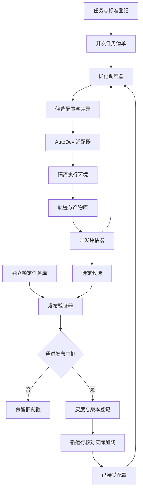

# AutoDev RSI MVP 详细需求文档

文档版本：1.0.0；日期：2026-10-12；状态：可评审需求草案，尚未实施。

本文与[Decision 小模型需求](./Decision小模型-MVP详细需求文档.md)共同承接[会议目标版 PPT](./AutoDev-RSI与自有Decision小模型-会议目标版.pptx)。文档版本仅管理需求稿，不表示软件已发布。所有接口均为拟定契约，需与 AutoDev、MaaS 和 TokenHub 团队确认。

## 1. 目标依据与首期成果

10 月 10 日会议 07:19–07:42 提出：在 AutoDev 中切换底层模型、提示词或 Skill，经评估系统评分，通过参数接口自动调整，再次执行与评估。17:24–18:21 提出可编辑题库、内部管理后台，以及启动、进度和报告的全流程 API。22:29–22:43 提出约三个月推进，首月完成打分框架。

本方向交付一个可验证的配置优化闭环：读取已接受配置，提出有限候选，在开发任务上重放，选择候选，经独立发布验证后灰度启用，保存并在新运行中实际加载；不通过则保留旧配置。

会议没有确定具体任务集、插件形态、质量阈值、算力预算或完整接口。以下技术设计与数值均为建议，须在第 4 周冻结。首期不训练基础模型权重；权重训练由另一方向独立交付。

## 2. MVP 范围

| 项目 | P0 范围 | 不进入首期 |
| --- | --- | --- |
| 任务 | 一类已有 AutoDev 任务，可固定输入和执行环境 | 所有 Agent、所有客户、任意开放任务 |
| 配置 | 模型版本、Prompt 模板版本、Skill 版本的白名单组合 | 自动修改权限、生产代码或训练权重 |
| 优化 | 每轮有限候选、开发评估、预算和停滞停止 | 无预算自主循环、任意工具自扩展 |
| 评估 | 可执行验证优先，人工标签与模型裁判辅助 | 仅凭模型自评宣称改进 |
| 发布 | 配置版本登记、独立验收、灰度、回滚、加载证明 | 优化器直接修改全量生产配置 |
| 后台 | 任务集、实验、候选差异、报告和版本查询 | 外部注册、支付、复杂多租户计费 |

建议首类任务为内部固定仓库中的代码修改任务，前提是已有可重复执行环境和可靠验收测试。若这些条件不具备，第 1 周选另一类具备独立成功判据的 AutoDev 工作流，保留同一接口。选定后发布 task_type 和 scope_version，不混入图片、报表等其他任务计算整体收益。

使用公开编程基准时，遵循其官方执行协议和数据授权；自建题库须明确测试充分性，隐藏测试不能进入优化输入。任务产生的代码、命令或文档均作为待验证产物。

## 3. 角色与用户故事

| 角色 | 可执行操作 | 权限边界 |
| --- | --- | --- |
| 任务负责人 | 定义任务、成功标准和质量底线 | 不独自裁决自己的候选收益 |
| 工程负责人 | 对接 AutoDev、执行器、调度、版本登记 | 不读取锁定验收答案来调优 |
| 评估负责人 | 冻结评测集、复核裁判、签发报告 | 独立管理留出集与发布门槛 |
| 发布负责人 | 根据通过报告灰度、回滚 | 每次发布绑定报告和配置哈希 |
| 优化器服务账号 | 读开发反馈、提交白名单配置候选 | 无发布权限、无留出答案权限 |

- 作为研发人员，我能创建一次实验，在相同任务和预算下比较当前配置与候选。
- 作为评估人员，我能看到成功依据、失败分类、成本未知情况和分组表现。
- 作为发布人员，我能确认候选经过独立验证，并证明后续运行加载了正确版本。
- 作为使用者，我在候选失败、基础设施异常或灰度退化时继续使用最后一个可靠配置。

## 4. 功能需求与完成条件

| 编号 | 需求 | 完成条件 |
| --- | --- | --- |
| RSI-01 | 任务与标准登记 | 每条任务关联不可变输入、标准、环境和数据组 |
| RSI-02 | 配置快照 | 模型 revision、Prompt、Skill、参数和依赖均可寻址 |
| RSI-03 | 基线重放 | 同一任务能按固定配置执行，记录随机性和环境差异 |
| RSI-04 | 候选生成 | 输出结构化差异和预期收益，禁止超出白名单 |
| RSI-05 | 参数切换 | 写入独立实验配置，读取实际加载状态，失败可恢复 |
| RSI-06 | 分层评估 | 规则、执行测试、裁判和人工均保留原始结果 |
| RSI-07 | 优化调度 | 并发、轮数、费用、时限、取消与停滞条件生效 |
| RSI-08 | 独立验收 | 优化器只收到发布判定，不获得留出任务答案 |
| RSI-09 | 灰度与回滚 | 流量固定分组，配置切换有并发保护和审计 |
| RSI-10 | 继承证明 | 新进程的运行记录包含实际配置版本和哈希 |
| RSI-11 | 报告与后台 | 展示基线差异、区间、分组错误和证据引用 |

## 5. 系统组成与数据流



数据流分为开发优化和发布验证。开发反馈可以给优化器，发布验证由独立服务运行。版本登记保存接受理由、验证报告、父版本和回滚目标。新配置是否真正继承，由运行启动时的实际加载回执确认。

工程建议：首期采用一个后端服务、关系数据库、对象存储和任务队列。执行器与训练环境通过适配器解耦，不提前拆成大量微服务。后台若采用 React，所有可见文案进入 i18n 资源；API 与前端展示相同软件版本。

## 6. 核心数据对象

| 对象 | 必需字段 | 不可变规则 |
| --- | --- | --- |
| Task | task_id、task_type、input_ref、rubric_version、environment_digest、group_id | 任务内容变化生成新版本 |
| DatasetManifest | dataset_id、version、split、task_refs、manifest_sha256 | 冻结后不替换任务或答案 |
| ConfigSnapshot | config_id、parent_id、model_revision、prompt_ref、skill_refs、parameters、sha256 | 模型别名在运行前解析为固定版本 |
| Experiment | experiment_id、baseline_config_id、development_manifest、budget、status | 实验开始后冻结比较条件 |
| Candidate | candidate_id、config_id、diff_ref、expected_effect、origin | 候选差异可追溯到生成者 |
| Run | run_id、task_id、actual_config_id、attempt、environment_digest、status | 每次尝试新 run_id，不覆盖失败轨迹 |
| Evaluation | evaluation_id、run_id、verdict、dimensions、evidence_refs、judge_version | 修订评价产生新 revision |
| ValidationReport | report_id、manifest_sha256、baseline/candidate refs、gates、signature_ref | 报告失效或撤销显式记录 |
| Release | release_id、scope、config_id、report_id、previous_release_id、state | 原子切换并支持回滚 |

所有业务对象包含 id、created_at、updated_at。任务关联、运行状态、版本引用存数据库；轨迹、产物和大报告存对象存储。对象引用为内部受控 ID，不接受任意 URL 抓取。凭据通过秘密引用注入执行器，不出现在配置快照和普通日志。

## 7. API 通用约定

以下 `/v1` 为本项目拟定路径，不能当作 AutoDev 或 MaaS 已存在接口。适配器必须形成接口映射表、联调结果和能力清单。

- 请求使用 JSON，身份由网关认证，tenant_id 从可信身份派生，调用者不能靠 body 越权。
- 写入及任务创建支持 Idempotency-Key。同一键、同一 body 返回原结果；相同键不同 body 返回 409。
- 异步创建返回 202 与 operation_id / status_url；结果读取采用游标分页。取消尽力终止，记录仍在执行的外部调用。
- 所有响应包含 trace_id、X-App-Version；模型或配置版本放业务响应，不能与软件版本混用。
- 错误格式为 `{"error":{"code":"CONFIG_CONFLICT","message":"配置版本已变化","retryable":false},"trace_id":"trace-demo"}`。示例 ID 不对应真实数据。
- 400 格式错误，403 越权，404 不存在，409 版本冲突，422 范围不支持，429 配额，503 外部依赖不可用。只重试明确可重试且幂等的请求。

### 7.1 内部业务接口

| 方法与路径 | 输入要点 | 返回与行为 |
| --- | --- | --- |
| POST /v1/datasets | task_type、scope_version、样本引用 | 草稿 dataset_id |
| POST /v1/datasets/{id}/freeze | expected_revision、split_manifest_ref | 不可变 version 与哈希 |
| POST /v1/configs | parent_id、固定模型 revision、Prompt/Skill refs | 新 config_id、sha256 |
| GET /v1/configs/{id} | 身份与版本 ID | 脱敏快照 |
| POST /v1/experiments | 基线、开发集、候选策略、预算 | 202、experiment_id |
| GET /v1/experiments/{id} | 实验 ID | 状态、进度、停止原因、已知成本 |
| POST /v1/experiments/{id}/cancel | expected_revision | 取消中或已取消状态 |
| GET /v1/experiments/{id}/candidates | cursor、limit | 候选及开发报告引用 |
| POST /v1/evaluation-jobs | 固定配置、任务清单、evaluators | 批量执行与评分 job_id |
| GET /v1/evaluation-jobs/{id}/report | job_id | 汇总与逐任务证据，按权限返回 |
| POST /v1/validation-jobs | 候选、基线、验证集 ID、gate_policy_version | 独立验收 job_id |
| POST /v1/releases | config_id、report_id、scope、灰度比例、expected_active_id | 门槛通过才创建灰度发布 |
| POST /v1/releases/{id}/rollback | reason、expected_active_id | 原子恢复已接受的上一版本 |
| GET /v1/runs/{id} | run_id | 实际配置、产物、状态、错误与资源 |

### 7.2 实验请求示例

```json
{
  "baseline_config_id": "cfg-baseline-demo",
  "development_dataset": {"id": "ds-demo", "version": "1.0.0"},
  "candidate_policy": {
    "mutable_fields": ["prompt_ref", "skill_refs"],
    "allowed_model_revisions": ["model-revision-demo"],
    "max_candidates_per_round": 3,
    "max_rounds": 5,
    "stop_after_no_improvement_rounds": 2
  },
  "budget": {
    "max_wall_seconds": 7200,
    "max_known_cost_cny": 200,
    "max_external_calls": 200,
    "unknown_cost_policy": "stop_new_calls",
    "max_concurrent_runs": 2
  },
  "gate_policy_version": "1.0.0"
}
```

上述数值仅说明字段含义，正式值在立项时配置。成本未知时不能显示 0 或用“预算未耗尽”继续调用。预算须在发起调用前预留最大预计费用，结算后释放差额，并将并发中的费用纳入上限。

### 7.3 AutoDev 适配器契约

| 能力 | 拟定内部方法 | 约束 |
| --- | --- | --- |
| 能力探测 | getCapabilities() | 返回可读写字段、版本、取消能力和运行隔离能力 |
| 配置读取 | readConfig(scope) | 返回实际快照和 revision |
| 实验切换 | applyConfig(config_id, scope, expected_revision) | 实验作用域独立于生产，无隐式全局覆盖 |
| 任务执行 | startRun(task_ref, config_id, budget, idempotency_key) | 回执包含 actual_config_id 与实际模型 revision |
| 运行读取 | getRun(run_id) | 状态、证据、资源和原始错误域 |
| 取消 | cancelRun(run_id) | 不支持时返回明确能力限制 |
| 恢复配置 | restoreConfig(previous_id, expected_revision) | 比较并交换，避免并行实验互相覆盖 |

若 AutoDev 只能全局改配置，P0 使用隔离实例或串行互斥执行。无法读取实际加载版本时，版本继承验收不能通过；不能只用“写接口返回成功”代替证明。

## 8. 执行状态和异常策略

实验状态：created、baseline_running、optimizing、candidate_selected、validating、ready_for_release、completed、failed、cancelled。无候选改进时以 completed 和 no_improvement 结束；这是有效实验结论，不是执行故障。

Run 状态：queued、running、succeeded、failed、timed_out、cancelled。Evaluation 的 verdict 分别为 pass、fail、unverified；Run 的 succeeded 只表示执行完成，不等于任务通过。

| 异常 | 记录与处理 | 对质量统计的影响 |
| --- | --- | --- |
| 上游超时或 Provider 失败 | 标 failure_domain=provider，有限重试，保留每次 attempt | 不冒充已证明的语义错误，另报不可用率 |
| 环境、网络或权限故障 | 标 infrastructure，暂停受影响任务，保留证据 | 分别给出端到端成功率和有效执行条件下质量 |
| 产物为空或结构不合法 | 标 candidate_output，任务失败 | 进入候选失败分母 |
| 裁判分歧、证据缺失 | unverified，进入独立复核 | 不计作通过，报告未验证比例 |
| 修改参数失败 | 当前候选停止，恢复已确认版本 | 不启动后续任务 |
| 灰度质量恶化 | 达预设触发条件回滚，保留故障运行 | 不删除失败样本 |

基础设施故障可使一次质量比较不可判定。报告仍必须展示全部任务上的实际可用性，不能删除所有失败后只报告成功任务。

## 9. 任务集与评估方案

建议第 1 周建立 30–50 个可重放任务用于环境调通，第 4 周形成开发集与独立验证集。目标为开发 150 个、锁定验证 100 个独立任务组，并为成本相近的批次固定输入和执行预算。数量为计划配额；若置信区间不足以支持结论，增加独立任务或延长试点，不增加同任务重复次数来伪造样本量。

同仓库同问题的变体、同模板派生和重复输入归入同一 group_id；分组切分。开发答案、裁判 Prompt 和参数可以调试，锁定验证答案由评估负责人管理。每次验证有预先登记的候选、任务哈希、统计方法与发布门槛。

成功标准包含必须满足的硬性条件与可比较的指标：代码任务的编译、测试和约定行为属于硬条件；可维护性或说明质量可由盲评辅助。固定基线和候选在相同任务、环境、工具和预算下比较，多轮重复用于估计随机性，以任务组作为统计单位。

模型裁判必须先与独立标签对齐，记录误判与分歧。候选优化器不得修改验收标准、验收器代码或锁定题库。评估器更新版本后，相关基线和候选均重新评估。

## 10. 验收协议

| 验收项 | P0 通过条件 | 交付证据 |
| --- | --- | --- |
| 接口和后台 | 完成任务登记、实验创建、进度、报告、取消与版本查询 | 联调记录及核心流程自动化测试 |
| 预算保护 | 轮数、调用数、并发、未知费用策略与取消测试通过 | 停止原因与预算台账 |
| 同条件比较 | 清单哈希、环境、模型、配置版本均明确 | 逐任务配对报告 |
| RSI 收益 | 至少一类任务的成功率配对差异，95% 区间下界大于 0 | 预登记的任务组 bootstrap 结果 |
| 质量底线 | 指定关键回归用例全通过，unverified 不超过冻结上限 | 回归和复核记录 |
| 资源代价 | 成功收益成立且成本、P95 时延不超冻结预算 | 完整成本与时延报告 |
| 状态继承 | 新进程实际加载已接受配置与哈希，旧版本可回滚 | 启动回执与回滚演示 |
| 权限分离 | 优化器无法读取留出答案、改变规则或发布 | 权限测试与审计记录 |

首月建议冻结：关键回归失败零容忍；unverified 上限 5%；单任务成本和时延以实测基线与业务约束定值。收益门槛不能以平均裁判分提高替代真实任务成功提升。若没有可证明的改进，平台功能可交付，但“RSI 改进能力达标”应标未通过。

锁定集避免反复调参：第 1 月预登记最多两次发布候选验证。若根据首轮失败原因修订候选，第二轮使用新采独立锁定任务，或采用评估负责人预先制定的多次检验协议。验收后公开答案的样本转为开发集。

## 11. 三个月排期与依赖

| 周期 | 工作 | 退出条件 |
| --- | --- | --- |
| 第 1–2 周 | 选任务、能力探测、隔离运行、对象与 API 契约 | 30–50 任务能重放，成功标准明确 |
| 第 3–4 周 | 内部后台、题库冻结、基线与报告、裁判对齐 | 完成首月评估平台，验收协议签定 |
| 第 5–6 周 | 候选差异、白名单参数写入、有限调度 | 开发任务自动闭环，预算停止有效 |
| 第 7–8 周 | 独立验证、版本登记、异常与取消 | 形成候选验收报告，权限隔离通过 |
| 第 9–10 周 | 固定流量灰度、实际加载回执、回滚 | 继承与退化恢复演示通过 |
| 第 11–12 周 | 新锁定验证、稳定性和交付整理 | 平台验收和收益验收分别出结论 |

建议工程负责人 1 名，后端/AutoDev 集成人员 1–2 名，评估/测试人员 1 名按阶段投入，产品或领域负责人参与标准制定。实际投入需确认，不能在兼顾高优先级 TokenHub 需求时仍无条件承诺三个月。

关键依赖：AutoDev 隔离运行、配置切换与加载读取能力；可重复环境；真实模型版本及费用查询；独立测试负责人。缺任一项时先完成评估平台，将对应闭环验收标为阻塞。

## 12. 与 Decision 方向的关系

两方向共享数据登记、执行证据、评估 API、版本对照和报告格式。Decision 服务通过模型版本提供业务判断，可作为 AutoDev 的受控路由组件。它的权重训练和独立验证由另一份需求负责。

RSI 首期允许切换已经独立验收的 Decision 版本，但不得自动触发权重训练并自行批准上线。若同时改变 AutoDev 配置与 Decision 权重，需要分解实验，避免无法归因。

## 13. 最终交付清单与未决项

交付：接口说明和联调映射、任务标准与分组清单、内部后台、执行适配器、有限优化调度、版本登记/继承/回滚、逐任务评估报告、权限及异常测试记录、部署和运行手册。

未决项：首类任务、AutoDev 插件或独立服务形态、基础设施预算、质量和资源阈值、留出集管理者、上线作用域。第 1–2 周解决范围与接口，第 4 周冻结门槛。

## 14. 来源与证据边界

- 内部会议：2026-10-10 15:30–16:03，钉钉“徐仁禄发起的视频会议”，前一轮重新读取原始转写；关键时段见第 1 节。
- 用户提供的 RSI 图解 MHTML：有效变化需要验证、保存并在下一轮实际继承；它是概念与工程导读，不是本项目已完成证明。
- 本文的架构、API、数据规模、统计门槛、排期拆分与角色配置均为实施建议。本文没有宣称已接入 AutoDev、训练模型或产生可验证收益。
