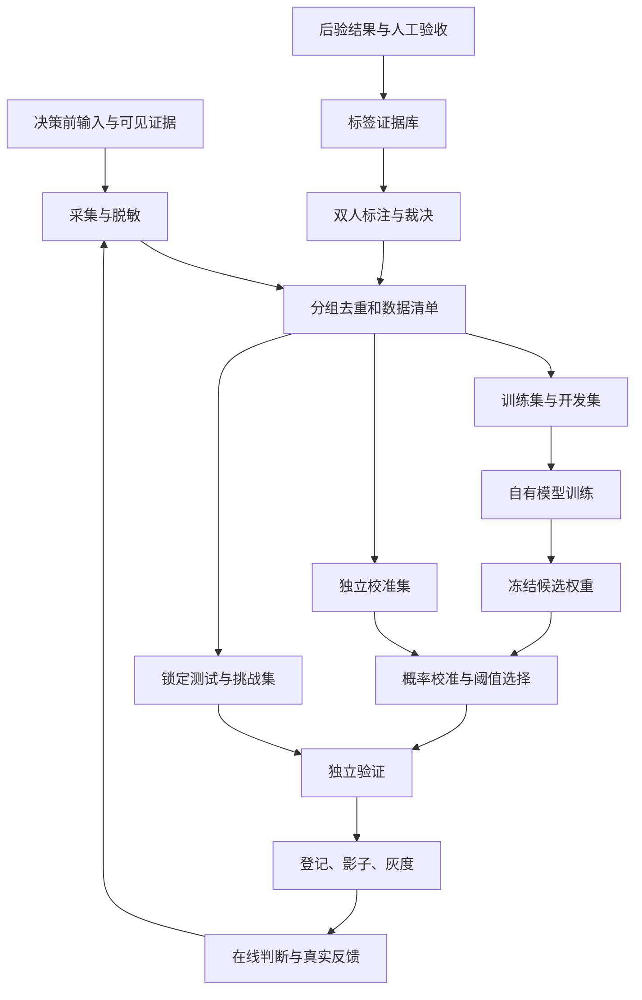

# 自有 Decision 小模型 MVP 详细需求文档

文档版本：1.0.0；日期：2026-10-12；状态：可评审需求草案，尚未训练或部署。

本文与[AutoDev RSI 需求](./AutoDev-RSI-MVP详细需求文档.md)共同承接[会议目标版 PPT](./AutoDev-RSI与自有Decision小模型-会议目标版.pptx)。文档版本不表示产品版本。接口、数据规模、模型路线和验收值为建议，前四周确认后冻结。

## 1. 会议目标与产品定义

会议 07:59–08:50 提出针对具体业务的小模型决策链路，涉及训练和 MaaS 接口，可以接入 AutoDev，也可以作为独立调度系统。21:33–22:18 提出不同企业拥有不同场景的决策模型，用户操作和反馈沉淀成数据，以增量训练比较新旧模型的准确率。

本方向训练并交付自己的模型权重或适配器权重，为固定业务问题输出有限动作及经过独立校准的概率。目标是以可控错误率完成高频判断，降低包含升级调用的总成本。System One 的类型化判断接口作为产品形态参考，不承诺复现 Jev 架构、训练方法或泛化能力。

首期任务建议为 AutoDev 结果的升级判断：在约定的内部任务范围内，判定当前结果是否可进入下一步，或需要强模型复核。任务选择是本次建议，会议并未定案；业务负责人可在第 1 周替换为另一个有真实结果和可靠标签的固定决策，随后冻结任务契约。

## 2. MVP 输入、动作与范围

| 项目 | P0 契约 |
| --- | --- |
| 输入 | 决策时可获得的任务说明、输出、证据摘要、确定性检查结果、适用范围版本 |
| 模型标签 | continue：已满足继续条件；escalate：存在语义错误或关键证据不足，需要进一步判断 |
| 业务动作 | continue 仅允许进入既有下一步；escalate 调强模型复核。确定性错误由策略直接拒绝或重试 |
| 拒判 | invalid_input、out_of_scope、model_unavailable、uncalibrated 由策略返回 abstain，不硬凑概率 |
| 输出 | 标签概率、推荐动作、模型 / 校准 / 策略版本、适用性、decision_id |
| 服务方式 | 单次同步推理 API、批量离线评估、训练作业、版本登记、影子和灰度 |
| 任务边界 | 一种升级判断，单租户内部试点，固定输入字段与标签定义 |

继续动作不等于自动部署、合并代码或执行高影响操作；既有业务审批与权限仍由业务系统执行。强模型复核没有解决问题时进入人工复核，不能无限递归升级。

分类、Skill 选择、候选排序为后续任务扩展，每种任务需自己的标签、模型头或适配器、校准与测试，不能拿二分类验收结果证明它们已可用。IoT/PLC 等工业场景需客户数据和专门错误成本标准，首期不包含在线工业控制。

## 3. 需求与交付对象

| 编号 | P0 需求 | 交付与完成条件 |
| --- | --- | --- |
| DEC-01 | 决策前状态采集 | 特征与后验结果物理分离，记录版本和授权 |
| DEC-02 | 标注后台与手册 | 双人独立标注、分歧裁决、unknown 流程 |
| DEC-03 | 数据清单与隔离 | 去重、分组拆分、不可变哈希和访问控制 |
| DEC-04 | 基线比较 | 规则、轻量分类器、强模型和小模型同集比较 |
| DEC-05 | 权重训练 | 可重建的数据、代码、基座、训练参数与产物 |
| DEC-06 | 校准与策略 | 概率来自模型输出，不来自文字自报；阈值独立选择 |
| DEC-07 | 独立验证 | 锁定真实分布测试集与挑战集、分组指标和区间 |
| DEC-08 | 推理服务 | 输入检查、固定版本、拒判、超时、限流和追踪 |
| DEC-09 | 反馈与更新 | 新数据审核、增量训练、旧任务回归与回滚 |

必交付自己的可训练权重产物。只封装外部 API 或 Prompt 判断可以成为基线，但不能作为“自有小模型已完成”的验收结果。

## 4. 业务决策和标签标准

标签针对决策时的状态，真值由独立证据验证。样本必须包含原始任务、待判结果、可见证据和任务专用评分细则。

| 标签 | 判定条件 | 例子 |
| --- | --- | --- |
| continue | 所有必需条件通过，关键结论有足够证据，没有已确认的语义缺陷 | 输出满足约定要求，测试及人工独立验收均支持 |
| escalate | 确认语义错误、关键检查缺失、必要条件未证实，进一步复核有意义 | 看似完成但遗漏约束，测试覆盖不足，依据相互冲突 |
| unknown | 标注者无法获得可靠真值，或标准无法裁决 | 输入要求歧义，原始证据丢失，专家无法一致裁决 |

unknown 不参加二元监督损失，也不强行变成 escalate 金标。它进入问题池，用于修订输入契约和设计范围检查；验收时单独报告比例。明确“关键证据不足”可标 escalate，无法知道是否缺证据则是 unknown。

模型判断之前，策略执行确定性硬检查。例如缺必需字段、不可识别模型版本、产物损坏直接拒判；可执行测试已经明确失败时直接走业务失败处理。模型承担剩余需要语义判断的问题。

标注记录包括 label、reason_code、evidence_refs、rubric_version、标注者 ID、时间、原始独立判断和裁决结论。reason_code 建议固定为 semantic_error、missing_requirement、unsupported_claim、evidence_incomplete、acceptable；无需收集模型隐藏推理或无依据的长解释。

## 5. 数据流与隔离边界



推理输入只能包含决策当时可获得的信息。后验成功、最终人工结论、实际选择动作、升级后答案存于标签证据库，不得进入模型输入。权限上，训练账号可读训练和开发数据，校准人员可读校准数据，独立测试负责人管理锁定测试。

## 6. 数据来源与采集方案

### 6.1 一条样本的字段

| 字段组 | 内容 |
| --- | --- |
| 身份与范围 | sample_id、tenant_id、task_type、scope_version、授权和保留策略 |
| 分组 | group_id、任务族、仓库或模板、会话 ID、源样本 ID、近重复指纹 |
| 决策前输入 | task_text_ref、output_ref、evidence_summary、check_results、decision_timestamp |
| 后验资料 | observed_action、outcome_ref、复核结果、执行版本、是否存在对照结果 |
| 标签 | 双标记录、裁决、reason_code、证据、label_source、rubric_version |
| 版本 | 生成模型、AutoDev 配置、工具与环境版本、输入 schema 版本 |

### 6.2 来源分工

| 来源 | 采集方法 | 使用限制 |
| --- | --- | --- |
| 真实历史与新任务 | 收集全部合规结果，保留失败、未采用和需复核案例 | 不能只采成功或已升级样本 |
| 受控重放 | 隔离环境中对同任务保存现有路径和强模型复核结果 | 派生样本保持同组，成本单独登记 |
| 人工构造边界 | 有意设置缺证据、遗漏条件、冲突结论等 | 主要用于训练和挑战，不能代表真实分布 |
| 教师伪标签 | 对训练池用固定强模型或多教师辅助标注 | 不写入校准、锁定测试金标，不覆盖人工裁决 |
| 在线反馈 | 用户操作、修改、重试、最终结果 | 作为采样信号，经过审核才能成为训练标签 |

### 6.3 选择偏差与反事实问题

只看到“升级后的成功”不能证明升级原本必要；只看到“继续后失败”也不能自动证明强模型一定能修复。首期标签描述当前结果是否满足继续条件，不承诺预测升级后的收益。

用随机抽样覆盖未升级和已升级任务，并对两类进行同等人工验收。对安全可重放任务，在离线环境运行继续与强模型复核的配对对照，记录两条路径实际质量与成本，用于估计策略收益。无法重放的真实生产任务只能做观察性分析，不宣称因果改善。

授权范围和可外发范围随数据登记；未经允许不向外部教师发送客户数据，不跨客户合并训练。训练导出前脱敏，排除凭据和私人信息，保留脱敏版本与原始资料的受控映射。

## 7. 数据规模、切分与冻结

建议最终采集 6,000 条经人工裁决的二元金标，另建立 600 条挑战金标，总计 6,600 条。原始 unknown 和拒绝入库的数据不计入配额。条数不是独立任务组数，两者分别报告。

| 集合 | 计划条数 | 允许用途 |
| --- | --- | --- |
| 训练 | 3,600 | 梯度训练、训练内采样和教师扩充 |
| 开发 | 600 | 选模型、超参、输入形式和消融实验 |
| 校准 | 600 | 拟合校准参数与冻结业务阈值 |
| 真实分布锁定测试 | 1,200 | 最终质量、覆盖率和成本验收 |
| 独立挑战集 | 600 | 冲突证据、长输入、注入、少数类、新任务族验证 |

训练和开发可以补充失败样本以改善学习；校准与真实测试保持试点生产分布，不能用平衡采样后的准确率替代线上风险。挑战集单列，不能混入主指标分母。

拆分方法：对同任务、同会话、同源变体、重放结果及同模板近重复建立关联组，先分组再拆分。文件哈希、文本近重复和来源关联一起检查，避免巨大模板簇强行随机拆散。锁定测试尽可能包含未见任务族或后续时间窗口；若仍来自同一内部客户，只声称覆盖该客户和冻结范围。

建议锁定测试至少包含 500 个独立任务组。校准集中应有至少 100 条 escalate 金标；生产分布若不足，扩大连续采集，不能通过改写类别比例冒充达标。第 2 周先完成 300 条试标，第 4 周形成约 2,000 条已审核开发数据，第 8 周完成目标清单冻结。

数据清单包含每条样本引用、split、group_id、标签与输入哈希、版本、采集时间、来源、授权及剔除原因。任何修订产生新 manifest version。验收负责人保留一份可审计的去重与无泄漏报告。

## 8. 标注实施与质量控制

1. 业务负责人准备 30–50 个正例、负例和边界例，逐项定义继续条件，发布 rubric 0.1。
2. 两名标注员先独立完成 300 条试标。界面隐藏教师预测、另一个人的答案、实际升级动作和模型品牌；只提供形成真值所需的结果证据。
3. 标注员填写 label、reason_code 与证据引用。标签依据是可观察事实，不是输出语气是否自信。
4. 二元标签不同、关键证据判断不同或任何 unknown 交领域专家裁决。保存裁决前标签，无法裁决就保留 unknown。
5. 批次加入 5% 隐藏重复，随机抽查 10%；每周汇总原始一致率、分歧类型和标签分布。
6. 规则变更时标记受影响样本，重标该批并发布新 rubric。校准和测试集全部双标与裁决。

| 检查 | 建议门槛 | 未通过时处理 |
| --- | --- | --- |
| 双标原始一致率 | ≥85% | 修订歧义规则、试标后重标受影响批次 |
| Cohen kappa | ≥0.70，连同类别比例一起报告 | 排查少数类与标准问题，不能只优化一个数 |
| 专家抽查错误率 | ≤5% | 扩大抽查，必要时整批退回 |
| 隐藏重复稳定性 | ≥90% | 培训并重新检查对应标注者批次 |
| 来源追踪 | 100% 可追溯 | 无证据标签不得进入金标 |

不要用裁决后的统一标签计算“标注员一致性”。伪标签必须标记 silver；测试集只允许人工金标与独立可执行真值。若未知比例高，先补输入和标准，不能靠更多训练修补定义不清的问题。

## 9. 模型选型与实验路线

| 路线 | 角色 | 决策依据 |
| --- | --- | --- |
| 确定性规则 | 全流程基线与输入硬门槛 | 对明确错误用代码，无需学习 |
| 文本特征加逻辑回归或小分类器 | 最低成本可训练基线 | 验证简单特征是否足够 |
| 固定强语言模型判断 | 当前质量和成本基线、训练教师 | 用同一人工标签验证，不能默认正确 |
| 中文 3B–8B 基座加二分类头与 LoRA | 首选权重训练路线 | 学习语义条件，固定短输出与可取 logits |

Qwen3-4B 可作为公开候选之一，具体基座 revision、权重许可、推理模式、依赖版本与训练兼容性必须在实验前记录。它的模型卡不证明本任务能力。首期选一个主基座和一个有条件备选，不同时维护多种复杂训练方案。[Qwen3-4B 模型卡](https://huggingface.co/Qwen/Qwen3-4B)

模型输入按固定模板编码状态，经过校验后保留任务、结果和关键证据；最多 4,096 token 作为初始实验上限。关键证据超长或无法保留时拒判，不能静默截断后继续放行。输入长度和并发须在验收环境冻结。

主路线：基座表征接二分类头，得到 escalation logit；训练分类头及 LoRA 适配器，冻结基础权重。推理不生成长说明。解释使用可验证 reason_code、规则结果和证据引用；没有可靠定位时不虚构解释。

若 MaaS 首期不支持分类头，备选为受约束二元标签序列评分，计算 continue / escalate 两个完整标签的条件分数并归一化，随后独立校准；标签长度和词表偏差须验证。不能把 JSON 中模型写出的概率当真实概率。

## 10. 训练作业与实验协议

### 10.1 初始配置

| 项目 | 建议起点 | 调整规则 |
| --- | --- | --- |
| 监督目标 | 二分类交叉熵 | 金标优先；类别失衡处理必须开发集验证 |
| LoRA | rank 16、alpha 32、dropout 0.05 | rank 8 / 16 作为首轮有限对照 |
| 学习率 | adapter 1e-4，分类头独立配置 | 1e-4 / 2e-4 两档，记录所有实验 |
| 有效 batch | 32，微批与累积按硬件定 | 先做显存和吞吐预检，不承诺 GPU 型号 |
| epoch | 最多 3，开发集早停 | 保存候选，避免靠测试选 epoch |
| 随机种子 | 最终主路线 3 个独立种子 | 重复种子衡量训练稳定性，不扩充测试样本 |
| 模型选择 | 开发集语义错误、风险覆盖曲线、业务损失 | 质量相近时看实测总成本 |

这些是实验起点，不是已验证最优参数。LoRA 减少需要训练的参数，但本项目显存、时延和成本仍需实测。[PEFT LoRA 官方说明](https://huggingface.co/docs/peft/main/package_reference/lora)

### 10.2 训练顺序

1. 训练前检查 schema、授权、标签、group 泄漏、类别覆盖和输入长度，失败即拒绝启动。
2. 在 300–500 条开发金标上建立规则、轻量分类器、未训练小模型、强模型的同集基线。
3. 只用训练集合做第一版监督微调，开发集决定超参、模型和早停。
4. 做 1,000 / 2,000 / 3,600 条学习曲线，观察错误类别和数据收益。
5. 需要教师数据时先做金标单独、金标加 silver 的对照。建议 silver 上限为训练记录的 30%，损失权重初始 0.5；开发指标变差则移除。
6. 冻结主模型后使用独立校准集拟合温度和策略阈值，模型、校准器与策略一起版本登记。
7. 独立测试负责人执行锁定测试。模型量化、合并适配器、输入模板变化或推理引擎变化后重新验证相关质量和校准。

消融至少包含：完整输入与去掉证据摘要、金标与增加 silver、冻结表征只训头与加入 LoRA。每个实验只改有限变量，记录 dataset hash、代码提交、镜像 digest、基座、参数、种子、硬件、耗时与费用。没有必要为首期加入强化学习；强化学习以明确奖励、可重放动作和额外验证为前置条件。

## 11. 概率校准与动作策略

模型输出 p_escalate，p_continue=1-p_escalate。首先验证分数对错误具有区分能力，再在校准集上拟合 temperature；校准不能修复一个无区分能力的模型。拟合所用数据与模型训练数据分离。[scikit-learn 概率校准说明](https://scikit-learn.org/stable/modules/calibration.html)

策略顺序：输入与范围检查、确定性硬检查、模型推理、概率校准、阈值动作、业务执行。未知范围或硬门槛不通过时输出 abstain；有效样本 p_continue 达到冻结阈值才 continue，否则 escalate。初始阈值网格 0.90 / 0.95 / 0.98，仅在校准集根据风险与覆盖率选定。

输出不是“高概率就一定正确”。报告 Brier、可靠性图、ECE（预先固定 10 个等频箱）、风险覆盖曲线和分组表现。二分类 Brier 定义为样本平均 `(p_escalate-y)^2`；ECE 受分箱影响，不作为唯一门槛。

强模型失败或仍缺证据时转人工；每任务最多一次强模型升级。每次动作记录推荐与实际执行是否一致，执行策略不能隐式篡改模型结果。规则、校准器、阈值与权重一起发布。

## 12. 独立验证与验收指标

设 C 为通过输入和硬检查后、属于冻结范围且具有可靠金标的样本，A 为其中模型策略自动 continue 的样本，E 为 A 中金标为 escalate 的样本。

- 自动继续覆盖率 = |A| / |C|。
- 自动继续错误率 = |E| / |A|，这是“错误放行风险”。
- 需升级漏检率 = 被 continue 的 escalate 金标数 / 所有 escalate 金标数。
- 无效或 unknown 率 = 相应样本数 / 全部提交样本数。
- 系统自动继续覆盖率 = 自动 continue 的样本数 / 全部提交样本数，单列以避免靠大量拒判美化主覆盖率。

| 维度 | 建议验收门槛 | 方法与证据 |
| --- | --- | --- |
| 输出完整 | 有效返回 100% 满足 schema；无效情况明确拒判 | 契约测试，不能替代语义验收 |
| 范围内质量 | 覆盖率 ≥70%，自动继续错误率 ≤5% | 真实分布锁定集，95% 风险区间 |
| 风险证据 | 错误率 95% 上界 ≤5% | 独立组单样本用 Wilson，重复组用 group bootstrap |
| 关键分组 | 每个预定关键组均报告风险、样本数、覆盖率 | 样本不足的组不启用自动继续 |
| 总成本 | 相同质量门槛下，相对强模型全量判断基线下降 ≥30% | 包含学生、升级、人工和部署摊销 |
| 时延 | 初始目标小模型 P95 ≤800 ms | 固定硬件、batch=1、输入≤2,048 token、并发4 |
| 全服务时延 | 4,096 token 上限、强模型及人工升级分别报告 | 冻结业务 SLA 后验收，不混算人工时延 |
| 可靠性 | 异常输入、注入、重复、依赖失败、回滚测试通过 | 挑战集与服务测试 |

PPT 中的 5% 是建议点估计目标，本文补充置信区间要求。测试点估计达标但上界不达标时，不能宣称风险目标已证明。示例：350 次独立 continue 中零错误时，Wilson 95% 上界约 1.1%；仍需确认任务独立性和分组覆盖。存在大量同组派生样本时使用组抽样，不能沿用独立条数计算。

若在 70% 覆盖下不能通过，则降低自动覆盖范围并如实报告 MVP 模型未达原目标，不能把大量 abstain 排除后只报漂亮准确率。上线范围仅包括经验证的关键组。

挑战集至少覆盖：关键证据缺失、伪造成功声明、输入中要求模型忽略标准的注入文本、长上下文、否定表达、罕见失败、新模板、版本变化。确定性输入异常应全部按协议处理；语义攻击单独报告错误与继续风险，不能以少量案例证明完整抗攻击能力。

锁定测试最多验证预登记的两次候选。失败后根据结果修改模型或阈值，需要新独立测试集，或事先约定的多次检验协议。测试集一旦用于开发，不再叫留出。

## 13. 成本与业务收益验证

每任务成本 = 小模型推理 + 升级比例×强模型成本 + 人工复核比例×人工成本 + 重试与基础设施成本；月总成本还包括 GPU 空闲、训练、标注与运维摊销。未知费用显式标记，不能用 0 代替。

比较必须使用相同任务、质量底线和实际执行策略。建议对可安全重放的任务离线配对评估“全部强模型判断”与“小模型判断加升级”，按 group_id 统计质量差异、成本区间与端到端完成率。仅计算输入 token 价格不构成总成本收益。

错误代价可表达为 loss = 错误继续数×业务损失权重 + 不必要升级数×升级成本 + 人工/延迟成本。权重由业务负责人提供；缺少可靠金额时保留归一化权重，不编造收入预测。

## 14. 接口契约

路径为拟定内部接口。沿用 RSI 文档的身份、Idempotency-Key、trace_id、X-App-Version、错误和对象存储约定。tenant_id 从身份派生，dataset/model/policy 必须检查归属；训练与发布权限分开。

| 方法与路径 | 输入 | 输出与约束 |
| --- | --- | --- |
| POST /v1/decision-samples | 决策前状态、证据和来源 | sample_id，schema 检查及授权登记 |
| POST /v1/decision-samples/{id}/outcomes | 后验结果引用、执行版本 | 独立 outcome revision，不修改输入 |
| POST /v1/annotation-jobs | 草稿数据集、rubric、标注员组 | 双标任务，不泄露教师标签 |
| POST /v1/annotation-jobs/{id}/labels | label、reason、evidence refs | 原始标签，权限限制独立提交 |
| POST /v1/annotation-jobs/{id}/adjudications | 裁决与理由 | 专家记录，保留全部历史 |
| POST /v1/datasets/{id}/freeze | split_manifest_ref、expected_revision | 分组与授权检查，返回 version/hash |
| POST /v1/training-jobs | train/dev 清单、基座、超参、预算 | 202、training_job_id |
| GET /v1/training-jobs/{id} | 作业 ID | 状态、开发指标、产物、成本与错误 |
| POST /v1/training-jobs/{id}/cancel | expected_revision | 尽力终止，保留 checkpoint |
| POST /v1/calibration-jobs | 固定权重、校准集、策略目标 | 校准器、阈值与版本 |
| POST /v1/validation-jobs | 固定权重、校准器、测试集、门槛 | 独立验证报告，训练者看汇总 |
| POST /v1/decision-models | 权重、基座、校准器、schema 和报告引用 | 不可变模型版本与适用范围 |
| POST /v1/decisions | 状态、固定模型和策略版本 | 同步 decision 记录；不执行业务动作 |
| POST /v1/decision-evaluation-jobs | 模型与数据集版本 | 异步批量评估，不执行生产动作 |
| POST /v1/decision-releases | 验收报告、模型/策略、灰度与预期当前版本 | 门槛通过才切换 |
| POST /v1/decision-releases/{id}/rollback | reason、expected_active_id | 恢复成套模型、校准与策略 |

### 14.1 训练请求示例

```json
{
  "task_type": "autodev_result_escalation",
  "schema_version": "1.0.0",
  "train_manifest": {"id": "ds-train-demo", "version": "1.0.0", "sha256": "demo-hash"},
  "dev_manifest": {"id": "ds-dev-demo", "version": "1.0.0", "sha256": "demo-hash"},
  "base_model_ref": "base-revision-demo",
  "recipe_version": "binary-lora-1.0.0",
  "hyperparameters": {"rank": 16, "alpha": 32, "epochs": 3, "seed": 17},
  "budget": {"max_gpu_hours": 20, "max_cost_cny": 1000}
}
```

这是字段示例，GPU 时数和金额不构成真实预算承诺。训练请求不携带锁定测试答案；作业启动前确认预算、环境支持、数据权限与可重建性。

### 14.2 在线判断示例

```json
{
  "task_type": "autodev_result_escalation",
  "schema_version": "1.0.0",
  "scope_version": "internal-task-scope-1.0.0",
  "model_version": "decision-demo-1.0.0",
  "policy_version": "1.0.0",
  "state": {
    "task": "完成约定的内部任务",
    "output": "待判结果摘要",
    "evidence": [{"id": "e-demo", "kind": "test_result", "summary": "约定检查结果"}],
    "checks": {"required_fields_present": true, "hard_failure": false}
  }
}
```

```json
{
  "decision_id": "decision-demo",
  "status": "decided",
  "recommended_action": "escalate",
  "probabilities": {"continue": 0.62, "escalate": 0.38},
  "calibration_version": "cal-demo-1.0.0",
  "model_version": "decision-demo-1.0.0",
  "policy_version": "1.0.0",
  "policy_reason": "below_continue_threshold",
  "latency_ms": 120,
  "trace_id": "trace-demo"
}
```

概率和耗时均为示例，不代表测试结果。recommended_action 由策略决定，不一定等于概率最大的标签。abstain 响应中 probabilities=null，包含拒判原因，禁止返回看似可靠的默认 0.5。

### 14.3 MaaS 训练与服务适配器

必须联调：submitTrainingJob、getTrainingJob、cancelTrainingJob、getArtifact、deployModel、getDeployment、infer、rollbackDeployment。每个方法记录真实 MaaS 路径、认证方式、状态映射、限制、预算与错误；不假定 MaaS 已有这些名称。

部署产物绑定基座 digest、adapter/head hash、tokenizer、schema、输入模板、校准器、策略和推理引擎。共享评估服务与 RSI 使用相同 /v1/validation-jobs 路径，通过 subject_type=config 或 decision_model 区分对象。

## 15. 在线策略、监控与增量训练

先影子运行：小模型只给建议，生产仍走既有策略。建议收集至少 1,000 条合规样本与 7 天覆盖，复核随机 continue 样本及全部疑难样本。样本量和天数是观察配额，不能替代质量门槛。

离线通过后按预定任务范围做 5%、20%、50% 固定分组灰度，步进时检查错误、unknown、覆盖、成本、时延与复核压力。不随机按单请求切换同一会话策略。灰度出现确定的严重误继续、版本错配或服务持续不可用时立即回滚成套版本。

线上抽检随机 continue 样本，不能只复核 escalate。监控输入分布、模型分数、类别、任务族、人工推翻率、升级后仍失败比例。分布漂移是采样和复核信号，不自动证明模型失效或自动开启训练。

增量更新每两至四周评审一次或按新任务变化触发。新数据先审核与分组，混入历史训练样本避免遗忘；旧版本回归集和新的独立测试用于验收。线上反馈不立即写入生产权重，训练服务没有发布权限。删除授权数据时能追踪受影响模型，停止相应使用并按数据协议处理。

## 16. 三个月排期与阶段门槛

| 周期 | 数据与算法 | 工程与验证 | 阶段门槛 |
| --- | --- | --- | --- |
| 第 1–2 周 | 选择任务、手册、300 条试标 | 采集 schema、MaaS 能力探测 | 标准可裁决、输入无后验泄漏 |
| 第 3–4 周 | 约 2,000 条已审核开发数据、基线 | 标注台、manifest、批量评估 | 一致性通过，冻结范围与验收 |
| 第 5–6 周 | 第一版监督微调、有限超参实验 | 训练作业与权重登记、取消 | 模型有区分力，作业可重建 |
| 第 7–8 周 | 6,600 条目标数据、学习曲线与校准 | 独立验证、推理 API、拒判 | 冻结候选与策略、测试无泄漏 |
| 第 9–10 周 | 影子抽检、误例分析 | 固定范围灰度、监控回滚 | 风险与总成本目标通过 |
| 第 11–12 周 | 一次增量训练、旧任务回归 | 新旧版本报告、交付整理 | 权重、API、验证与回滚均可验收 |

建议算法负责人 1 名、数据/评估负责人 1 名、工程集成人员 1 名，与 RSI 共用基础设施；两名标注员与领域裁决者按数据量配置。资源不足时先收缩业务范围，不省略独立测试。

失败停止条件：标签标准仍不清晰、实际数据不足、主模型无区分力、校准后覆盖不足、包含升级的总成本不下降，或无法拿到可部署权重。此时交付基线与数据报告，保留规则加人工，不宣称训练 MVP 达标。

## 17. 交付清单与待确认事项

交付包括：标注手册与正反例、采集字段和授权规则、双标/裁决记录、分组清单及无泄漏报告、基线/消融/学习曲线、训练配方与可重建环境、自己的权重或 adapter/head、校准器与策略、独立验收报告、推理和训练 API、影子/灰度/增量更新及回滚手册。

第 1–2 周需确认：升级判断作为首任务是否合适、现有 AutoDev 数据授权、继续条件、强模型复核服务、MaaS 分类头与 LoRA 支持、负责人和 GPU/标注预算。第 4 周冻结错误代价、覆盖与风险目标、硬件负载、测试协议。

## 18. 来源与事实边界

- 原会议的两个用户故事、企业反馈训练与三个月安排，以前一轮重新读取的钉钉原始转写为依据。
- [TypeSafe API](https://docs.typesafe.ai/api)：参考有限选项和结构化判断的产品接口，本项目独立训练和验证。
- [Qwen3-4B 模型卡](https://huggingface.co/Qwen/Qwen3-4B)：候选基座能力与许可核查入口。
- [PEFT LoRA](https://huggingface.co/docs/peft/main/package_reference/lora)：参数高效训练机制参考。
- [scikit-learn 概率校准](https://scikit-learn.org/stable/modules/calibration.html)：校准方法与独立数据要求参考。

公开资料核对日期为 2026-10-12。模型性能、数据规模、训练超参、接口、排期、风险和成本门槛均为本项目建议，未开展训练和实际收益测试。
