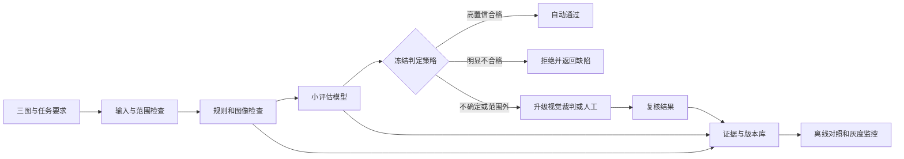

# 电商换装图片质检 MVP 实施与验收方案

首期以电商单人换装图片为试点，输入原人物图、目标服装参考图、生成结果和换装要求，输出通过、拒绝或人工复核，以及分维度评分和缺陷证据。系统先建立可信数据、统一标准和可重放评估，再训练专用小模型承担稳定、高频判断，疑难样本升级到视觉大模型或人工。

三个月目标是交付可接入 AutoDev / TokenHub 的质检 API、标注与评估后台、一个经过独立验证的专用小评估模型，以及一个客户流程的受控试点。下述规模、阈值、人力和性能均为立项建议值；第 2 周冻结输入范围与运行配置，第 4 周确认验收协议，阶段结论依据真实数据决定。

## 一 MVP 范围与交付边界

| 项目 | 首期范围 |
| --- | --- |
| 业务范围 | 单个成人、单件上装或连衣裙、静态图片；以商家选定的固定画面类型为主 |
| 必需输入 | 原人物图、服装参考图、生成结果、要求、允许变化清单；缺任何关键参考时不自动放行 |
| 主要判断 | 服装款式与颜色、主体保持、可见人体结构、穿着贴合与边缘、清晰度和基本美观 |
| 输出 | pass / reject / review；维度等级、缺陷类型、严重度、图中证据位置及模型与标准版本 |
| 产品交付 | 单张异步 API、批量任务、同次生成候选筛选、人工复核台、版本对照和审计报告 |
| 暂不纳入 | 多人、多件服装组合、视频、任意商业风格、精确面部身份认证、服装尺寸适配或真实试穿物理保证 |

人体局部在原图中不可见时，不要求模型推断不可见事实。光线改变、允许更换背景等要求必须显式传入，避免把客户允许的变化标成缺陷。内容安全仅作为指定风险类别的辅助筛查，不以 MVP 证明完整合规能力。

## 二 数据单元与采集方式

数据单元是一条任务和一个生成结果，必须同时保存三张关联图片及要求。每个结果记录 task_id、group_id、客户与任务来源、SKU、原人物素材编号、生成模型和版本、Prompt / Skill 版本、seed、参数、图片哈希、生成耗时、重试次数、实际费用或费用未知标记。原始文件存对象存储，元数据保存引用，不把原图和凭据混入普通日志。

| 来源 | 建议占比 | 收集方法与用途 |
| --- | --- | --- |
| 经授权的真实任务 | 60% | 试点客户历史或新生成任务，保留全部候选，不能只收已交付的好图 |
| 受控生成任务 | 30% | 固定资产与要求，用不同生成模型、版本、seed 产生成功和失败候选 |
| 受控缺陷合成 | 10% | 模糊、压缩、截断、局部遮挡等已知变化；用于训练和挑战，不冒充真实失败 |

比例是开发数据的采集配额，不改变生产验收集分布。人工修图稿只有在参考及修图过程明确、客户确认可交付时才能作为正样本；客户点击下载或未投诉不自动等同合格。单独记录最终采用、退回、返工和投诉，用作后续业务验证。

采集前记录素材授权、可用于训练的范围和保留期限。客户数据默认隔离；未经允许不跨客户训练、不上传外部模型服务。人物素材使用授权成人素材，精确身份识别与人脸特征库不在首期范围。

## 三 三个月的数据规模与隔离

建议最终获得 6000 条结果记录的人工金标，独立统计单位另按数据组核验。另构造 1500 对同任务候选偏好比较，其中训练 900 对、校准 150 对、留出验收 450 对；每一对及其图片遵循所在记录集合的隔离规则，偏好对可复用已有结果，不计作新增独立图片样本。

| 数据集 | 条数 | 使用方式 |
| --- | --- | --- |
| 训练与开发 | 3600 | 训练学生、教师辅助标签、开发规则和 Prompt；含成功、自然失败与少量合成缺陷 |
| 校准集 | 600 | 选阈值、校准概率、检查拒判与覆盖率；不参加梯度训练 |
| 生产分布锁定验收集 | 900 | 连续或随机抽取授权真实任务，保持实际好坏比例，用于误放行和覆盖率验收 |
| 锁定缺陷挑战集 | 900 | 按款式错误、颜色偏移、主体改变、严重结构错误、边缘与遮挡、画质等分层；至少 300 条严重缺陷 |

必须按原人物素材、SKU、生成任务及近重复图片分组隔离。同一任务的多个 seed、同一缺陷合成源、同一偏好对不能跨集合。优先先划分人物与商品资产池，再在各池内生成，避免分组后形成无法拆分的大量关联样本。用文件哈希和感知哈希排查重复；保留拆分清单、规则和哈希。

至少留出未参与训练的生成模型版本，并在可获取时加入一个新客户的数据。若只有一个客户，验收结论只能覆盖该客户和约定画面类型。客户与商品覆盖达不到条件时缩小自动放行范围，不能通过增加同图重复评分补足样本量。

第 2 周先建立 300 条金标用来修订标准；第 4 周累计 2000 条；第 8 周累计 6000 条并冻结校准和验收集。验收集只由独立测试负责人管理，训练及优化人员不查看其答案。失败后如需新训练版本，再采新验收样本或按预先约定的多次测试协议处理，不能反复针对同一留出集调参。

## 四 标注流程和质量控制

1. 业务负责人先提供 30–50 个合格、返工、严重失败的示例，形成标注手册 v0.1。

2. 两名标注员独立看原人物、目标服装和生成图，对维度等级、缺陷类型、严重度和总判定标注。界面隐藏生成模型名称、教师分数和另一人的标签。

3. 每个缺陷写清类别、位置、可观察事实和修复方向。框或区域是证据，不要求所有样本都做精细分割。

4. 两人总判定不同、核心维度相差两级、严重缺陷有分歧时交业务专家裁决。证据不足记 unknown，不能强行改成通过。

5. 每批随机抽查 10%，加入 5% 隐藏重复样本检查个人稳定性；每周汇总混淆矩阵、分歧和手册修订。

| 检查 | 建议通过标准 | 不通过时处理 |
| --- | --- | --- |
| 总判定一致性 | 原始一致率至少 85%，Cohen kappa 至少 0.70 | 报告类别分布；排查标准歧义并重标受影响批次 |
| 核心维度一致性 | 加权 kappa 至少 0.65 | 增加正反例，合并无法可靠区分的等级 |
| 复核抽样 | 标签错误不超过 5% | 扩大抽检或整批退回 |
| 不可裁决样本 | 显式保留 unknown 和原因 | 不用作二元通过训练；上线时同类样本转复核 |

一致性先在裁决前统计，不能用专家统一后的标签伪造高一致率。严重稀有缺陷不能仅靠 kappa 判断质量，要单独检查漏标率。客户验收集全量双人独立标注并裁决，训练集至少维持同样的总判定双标。

## 五 评分标准与判定规则

所有维度使用四级标准：0 为明显错误且不可交付，1 为存在需要返工的问题，2 为可交付，3 为表现优秀。展示分数映射为 0、40、80、100。unknown 是证据不足，N/A 仅用于确实不可观察或不适用的子项，两者不能混用。

| 维度 | 权重 | 2 级可交付锚点 | 严重缺陷示例 |
| --- | --- | --- | --- |
| 服装一致性 | 35% | 指定款式、主颜色、关键图案和裁剪特征保持 | 错款、关键图案丢失、主颜色明显改变 |
| 主体保持 | 20% | 与原图相比人物外观及要求保持的内容无明显改变 | 明显换人、要求保持的主体部分被替换 |
| 可见人体结构 | 20% | 可见手、肢体和姿态无明显异常 | 多肢、严重变形、身体断裂 |
| 穿着贴合与边缘 | 15% | 袖口、衣领、遮挡关系和身体边界自然 | 严重穿帮、服装漂浮、关键区域缺失 |
| 画质与基本美观 | 10% | 主体清楚、无明显模糊噪点、光照基本合理 | 主体无法辨认、严重损坏或大面积缺失 |

总分为各维度映射分数乘权重求和，主要用于排序和解释。不能用美观高分抵消错款、换人或严重结构错误。核心维度的最低标准必须全部满足；核心维度证据不完整时总判定为 review。手不可见可记手部子项 N/A，但必须继续判断可见的人体结构。

初始策略：输入完整、属于已验收范围、所有核心维度至少 2 级、总分至少 80，且校准后的整体合格概率达到放行阈值时，才可自动 pass；高置信明显不合格时 reject，其余 review。放行概率初始候选阈值 0.98，拒绝概率初始候选阈值 0.95，最终阈值在校准集按风险和覆盖率选定后冻结。概率不得取自 VLM 自报的“我有 98% 把握”。

美观 3 级由相同任务的 A/B 候选盲评辅助建立，只比较两张都满足核心条件的图；平局和无法比较也是合法标签。首期不建立跨商品、跨风格的统一审美排行榜。

## 六 模型选型和对照实验

| 路线 | 首期角色 | 选择依据与边界 |
| --- | --- | --- |
| 规则与图像检查 | 文件合法性、分辨率、缺图、损坏、重复图、明显画质问题 | 先用确定性代码覆盖确定性问题；阈值需依据素材分布校准 |
| SigLIP 2 视觉编码器加多头预测 | 首选专用小模型路线 | 对原人物、服装和结果分别提取全局与局部特征，训练合格概率、缺陷和等级预测头；低成本但细节与跨图关系需验证 |
| Qwen3 VL 4B Instruct | 对照候选或复杂一致性判断的学生路线 | 支持多模态输入；以三张图和要求做监督微调，控制输出长度；不预设一定优于编码器路线 |
| 现有强视觉模型 | 开发阶段教师、疑难升级 | 同批任务与人评比较后选定；只处理获准使用该服务的数据 |
| Q Align、ImageReward | 画质、审美或文图偏好的辅助对照 | 不单独承担服装保持、主体一致与业务合格判定 |
| Q Judger | 离线参考裁判 | 27B、面向生成图片多维评分，不作为首期低成本学生；不能直接证明换装三图业务判断能力 |

[SigLIP 2 模型卡](https://huggingface.co/google/siglip2-so400m-patch14-384)、[Qwen3 VL 4B 模型卡](https://huggingface.co/Qwen/Qwen3-VL-4B-Instruct)、[Q Judger 模型卡](https://huggingface.co/Qwen/Qwen-Image-Bench)、[Q Align](https://github.com/Q-Future/Q-Align)、[ImageReward](https://github.com/zai-org/ImageReward)。这些是候选能力来源，选型结论以本任务测试为准；固定模型 revision，并核对具体权重、依赖与训练数据的授权范围。

第 3–4 周用相同 300–500 条开发金标比较规则、现成评分器、强 VLM、编码器探针和未微调 4B 模型，报告分维度错误、成本、P95 时延和升级比例。只保留一个主学生路线，另一路作为有条件备选，避免三个月同时维护多套训练系统。Jev 是文本决策模型，不纳入图片的直接裁判。

## 七 小评估模型训练和概率校准

**编码器主路线：**先冻结视觉编码器，提取三张图的全局特征、服装和可见身体区域的局部特征，加上参考与结果的特征差异、相似度和要求特征，训练小型融合网络及多头预测器。任务包括整体合格二分类、严重缺陷多标签、各维度有序等级和同任务偏好排序。相似度只是输入特征，不能直接当作业务真值。全局低分辨率编码不足时保留局部高分辨率裁剪，禁止把细小图案或手部信息在预处理时丢掉。

**4B 备选路线：**对固定三图输入和 Rubric 做 LoRA / QLoRA 监督微调，以短结构化等级、缺陷标签和证据为目标。优先冻结视觉塔，确认错项后再决定是否适配部分视觉层。机器置信度采用可验证的分类头或受控候选标签 logits；生成式自报概率不能作为放行依据。复杂定位证据由独立复核或升级裁判提供，不把无法验证的长解释加入核心损失。

| 步骤 | 具体工作 |
| --- | --- |
| 第一轮 | 用 2000 条以内开发金标做冻结编码器探针，测学习曲线并确定缺陷类别 |
| 主训练 | 用冻结拆分后的 3600 条训练样本；缺陷重采样和多任务损失，严重缺陷单独报告 |
| 教师辅助 | 教师仅标注训练池；可用于软标签和疑难挖掘，保留人标权重与来源；不覆盖人工金标 |
| 偏好学习 | 同任务候选成对学习；两张图和所有派生裁剪保持在同一数据组 |
| 消融实验 | 金标单独、加教师标签、加局部裁剪、加排序目标各做对照；收益以开发指标判断 |
| 校准 | 独立校准集做温度缩放或适当概率校准，选 pass / reject / review 阈值，冻结模型与策略 |
| 量化部署 | 若做量化，重新检查质量、概率与时延，不能沿用量化前阈值直接发布 |

禁止标签破坏性增强：改变服装颜色、翻转带方向图案、改变人物主体、遮挡关键证据都会改变标签。亮度、压缩等增强也需确认仍保留原标注条件。模型和裁判不得在同一留出集上共同优化。

学习曲线在 1000、2000、3600 条训练规模检查。若编码器路线在细节一致性上遇到明显上限，使用 4B 备选或扩大对应标注；若两条路线都不达标，则保留规则加人工系统，停止自动放行承诺。

## 八 评估系统架构与接口

| 模块 | MVP 交付 |
| --- | --- |
| 数据登记 | 素材引用、授权、group_id、哈希、拆分、标签及版本 |
| 标注后台 | 三图并排、维度标签、缺陷区域、盲标、裁决、抽检 |
| 运行器 | 单张与批量队列、幂等任务键、超时、有限重试和任务状态 |
| 评估器路由 | 规则、小模型、授权的强裁判与人工复核适配器 |
| 证据库 | 原始结果、校准概率、证据、成本、配置、模型与标准版本 |
| 策略和报告 | 阈值、pass / reject / review、同条件对照、分组指标、灰度与回滚 |

建议接口：POST /v1/quality/jobs 创建任务，GET /v1/quality/jobs/{id} 查询，POST /v1/quality/batches 批量提交，POST /v1/quality/reviews/{id} 提交人工复核。服务通过 `X-App-Version` 响应头暴露版本，实际名称沿项目约定；模型、Rubric、数据和策略版本独立记录。输入按对象编号获取授权素材，不允许任意 URL 读取成为服务能力。

预测结果至少包含 job_id、三态业务判定、每维度等级、p_acceptable、缺陷与严重度、证据引用、复核原因、model_revision、rubric_version、policy_version、耗时、费用及费用是否已知。execution_status 与业务判定分开：上游错误、图片读取失败和超时是运行错误，不能写成不合格或合格。初期只建议重新生成或修图，不自动无限重试；每任务设最多一次自动重生成的可配置上限。

## 九 验证口径与防止指标失真

生产分布集和挑战集必须分别报告。生产分布集验证真实业务风险；挑战集验证特定失败能力。不能把挑战集中过采样的坏图比例当作线上分布，也不能把多 seed、同图多次评估或偏好对数量当成独立任务数。

| 指标 | 明确定义 |
| --- | --- |
| 自动放行不合格率 | 人工判定不合格且自动 pass 的数量 / 全部自动 pass 数量；这是客户看到的放行风险 |
| 坏图误放行率 | 自动 pass 的不合格数量 / 全部人工不合格数量；与上一指标分母不同 |
| 严重缺陷检出率 | 系统明确检出严重缺陷且未自动通过的数量 / 全部人工严重缺陷数量；仅转复核但没发现缺陷不计检出 |
| 自动处理覆盖率 | 自动 pass 加自动 reject 数量 / 全部有效且范围内任务数量；同时分别报告两者占比 |
| 好图误拒率 | 人工合格却自动 reject 数量 / 全部人工合格数量 |
| 概率质量 | Brier、固定等宽分箱 ECE、可靠性曲线；范围外及 unknown 单独报告 |
| 业务成本 | 每张最终合格图的生成、质检、重试、人工复核成本，加固定部署摊销 |

质量比例采用 95% 单侧精确二项置信界或合适的分组 bootstrap。相关样本以任务 / 人物 / 商品分组计算，不能简单套独立二项公式。零误放行也必须报告样本量和上界：在独立假设下 n 次自动通过零错误，95% 单侧上界为 `1 - 0.05^(1/n)`；300 次约为 1%。统计方法参考 [NIST 置信区间说明](https://www.itl.nist.gov/div898/handbook/prc/section2/prc241.htm)。

线上转人工的样本全部记录，自动通过也必须随机抽检，避免只看复核数据。开发错误集可以反复看；最终验收集冻结、独立执行，一旦成为调参依据即失去最终验收资格。

## 十 三个月开发排期

按立项日 T0 开始的 12 周安排，不预设今天已获得数据或人力。数据、平台和模型并行推进，但每个阶段有继续投入的条件。

| 周次 | 平台与工程 | 数据与模型 | 阶段产出 |
| --- | --- | --- | --- |
| W1–W2 | 输入契约、素材登记、标注原型、队列与运行记录 | 确认授权资产；300 条双标；Rubric v0.1；标注员培训 | 冻结首期范围、生成模型来源、硬件基准和资源预算 |
| W3–W4 | 单张 / 批量 API、复核台、规则与报告；回放测试 | 累计 2000 条金标；候选对照；初步编码器模型；修订 Rubric | 月一验收：数据质量达标、评测可重放、主模型路线选定 |
| W5–W6 | 训练任务、版本登记、评估器路由 | 累计 4000 条；主模型训练、困难样本挖掘；必要时启动 4B 备选 | 学习曲线和消融报告，不提前上线自动放行 |
| W7–W8 | 校准策略、影子 API、失败与成本观测 | 累计 6000 条；1500 对偏好；固定模型、校准集和锁定验收集 | 月二验收：对照质量、校准、成本与时延报告 |
| W9–W10 | 独立验收、灰度开关、回滚、AutoDev / TokenHub 适配 | 独立测试负责人执行锁定测试；至少 1000 条连续任务影子运行 | 达标才灰度 10%；否则 review 为主并补新数据 |
| W11–W12 | 通过后逐步放量、客户复核与计费记录、交付文档 | 再收至少 1000 条连续线上任务；随机抽检 pass；业务 ROI 对照 | 月三验收：客户确认、质检系统、小模型及报告交付 |

1000 条影子和 1000 条后续任务是运行量目标，需报告独立 group 数；不足流量时延长验证，不能把重跑结果补成新任务。严重缺陷或范围扩展触发重新验收。

## 十一 验收标准

以下数值是建议目标，W4 由业务和技术负责人签字冻结；不能为了通过最终测试而临时放宽。验收质量、覆盖率、成本和时延必须来自同一模型与同一策略版本。

| 层次 | 月一 | 月二 | 月三最终门槛 |
| --- | --- | --- | --- |
| 数据 | 2000 条金标；一致性与抽检达标 | 6000 条、独立拆分、1500 对偏好 | 两套锁定验收集满足数量与覆盖；泄漏检查通过 |
| 系统 | API、队列、复核、任务重放；错误独立记录 | 证据、模型、Rubric 和策略版本可追踪 | 权限隔离、幂等、超时、限重试、灰度和回滚全部演练通过 |
| 小模型质量 | 报告基线，不要求自动放行 | 开发 / 校准集显示可用阈值；报告所有分组错误 | 自动放行不合格率点估计不高于 3%，95% 单侧上界不高于 5%；至少 300 个独立自动通过样本 |
| 缺陷能力 | 建立类型和严重度金标 | 严重缺陷专项报告 | 至少 300 个独立严重缺陷案例；检出率至少 95%，95% 单侧下界至少 90% |
| 自动化覆盖 | 单独报告通过与拒绝比例 | 影子评估覆盖曲线 | 生产分布集自动处理至少 40%；好图误拒率不高于 5%，95% 单侧上界不高于 8% |
| 概率与排序 | 标签口径固定 | 校准曲线及偏好对照 | ECE 不高于 0.05；Brier 不劣于冻结基线；偏好判断一致率至少 75%，盲评、平局处理明确 |
| 性能 | W2 固定硬件、输入和负载 | 实测学生与升级路径 | 约定单卡、三图输入、并发 4 条件下小模型 P95 不高于 2 秒；含升级异步任务 P95 不高于 15 秒 |
| 业务收益 | 人工质检基线 | 包含升级和重试的成本估计 | 相同质量门槛下每张合格图总成本至少下降 20%；人工质检时长至少下降 20%；质量不得劣于约定基线 |

性能测试输入：按约定预处理上限、三图合计至多 6 个裁剪、冻结推理精度与部署批大小，至少 500 个任务，报告冷启动和稳态；时延包含排队，人工完成时延另报告，不能并入 15 秒机器路径后隐藏。若选 4B 路线达不到机器时延预算，可以缩小其自动化覆盖范围，但不能隐瞒升级比例或改变测试条件。

偏好一致率基于独立的留出偏好对，不使用训练对验收。ECE 固定 10 个等宽概率区间，报告各箱样本数；概率目标不能替代误放行硬门槛。没有足够样本的客户 / 商品子组默认转 review。未知样本、运行失败和范围外流量都要另报，不能从系统报告消失。不可裁决样本若被自动 pass，作为验收阻断事件调查，不能按合格计入分母来降低风险。

业务对照建议以 group 为单位随机分配“原人工流程”和“质检辅助流程”，或用盲法配对重放。报告配对收益区间；若总流量不足以支持业务收益结论，只能交付技术试点，不能宣布商业验收完成。

## 十二 人力 算力和标注预算

建议最低配置：1 名全职后端 / 平台工程师、1 名全职算法工程师、1 名全职前端兼测试工程师、0.5 名产品 / 领域负责人，以及两名标注员和业务裁决支持。约 3.5 个持续投入人力，标注按工作量单列。若只能利用现有团队空闲时间，三个月优先交付评估底座、规则与人工复核，不能同时承诺训练和付费试点验收。

6000 条三图金标若每人每条平均 45–90 秒，双标约需 150–300 人时；再加裁决、抽检和 1500 对偏好，建议准备 220–400 人时。W2 用真实 300 条计时校准，不能按此估算直接外包报价。

算力分阶段：先申请现有一张 24GB 级 GPU 跑编码器和推理探针；4B 适配预留一张 48GB 级 GPU 的实验配额，实际可行性由 W2 三图分辨率和 LoRA 试跑确定，显存描述不是运行保证。强教师优先使用现有获准端点，不要求为了离线对照新增常驻 27B 服务。

W2 冻结 GPU 小时、教师输入 / 输出量、存储和标注总量上限。先给训练实验设置有限次数与资源上限，达到上限停训评审；不预设训练越多就越好。预算公式分别记录标注人时成本、GPU 小时成本、教师费用、存储和运维，费用未知不能按零计算。

## 十三 风险与降级条件

| 触发条件 | 必须采取的动作 |
| --- | --- |
| W2 无授权三图或商品 / 人物多样性不足 | 缩小输入范围，改做画质 / 明显缺陷辅助质检；暂停一致性能力承诺 |
| 人标一致性不达标 | 修订标准和重标，暂停受影响标签的模型训练 |
| 小模型“高分”但误放行不达标 | 停止自动 pass，转 review；加真实失败案例，使用新的独立验收数据 |
| 编码器在局部缺陷上达到上限 | 增加局部特征或采用 4B 备选，不无限堆全局相似度阈值 |
| 人工升级过多导致成本不成立 | 调整有限支持范围；保留全量质量与覆盖指标，不靠只选容易样本掩盖问题 |
| 新生成模型、新客户或新服装类别上线 | 先影子评估，再单独验收，未经验证的组全部 review |
| 灰度出现严重漏检或放行风险超标 | 关闭自动放行、回滚策略，保留运行证据并通知项目负责人 |

月三只对 Prompt / Skill 候选提供优化建议和受控对照，验证后人工批准新版本。生成器不能修改自己的验收规则或读取锁定答案；小模型新版本也要接受独立裁判验证。自动改模型权重、无人值守递归发布和无限自动重生成都不属于首期交付。

## 十四 立项前需确认的四项

- 试点客户和首期画面类型，客户是否可提供原人物、商品参考、全部生成候选及真实返工记录。

- 标注、训练、客户隔离和外部教师使用的授权范围。

- 人员周投入、可用 GPU 与教师服务，以及三个月预算上限。

- W4 冻结误放行、覆盖率、性能和单位成本门槛，以及最终验收负责人。

推荐首期项目名称为“电商换装图片质检 MVP”。对外能力承诺以验收过的输入范围、缺陷类型和质量门槛为准。

