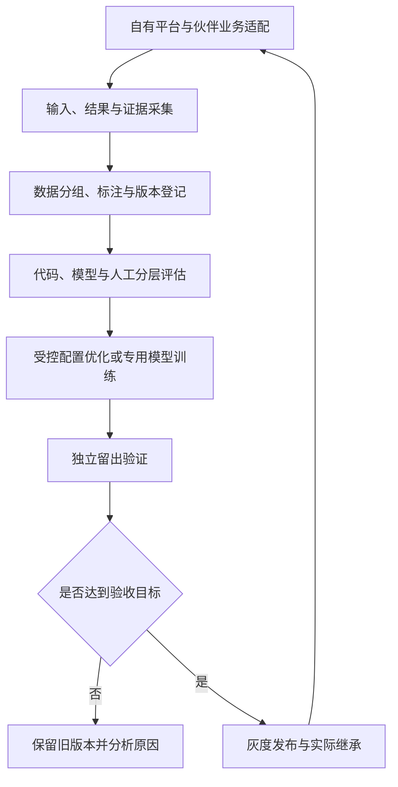

# RSI 智能评估与持续优化项目立项方案

> 文档版本：1.0.0；日期：2026-10-13；状态：立项评审稿。
> 对应材料：[立项申请 PPT](./RSI智能评估与持续优化项目-立项申请版.pptx)。

## 1. 立项申请摘要

申请以三个月为首期周期，建设统一评估与持续优化底座，优先在 AutoDev 和 TokenHub 两个自有平台验证研发质量闭环与质量路由，并以可复用技能和接口支持合作伙伴推进报表审核、图片生成 Review 与提示词优化。

首期预期形成两项自有平台验证报告、一项合作伙伴技能试点，以及可复用的评估接口、版本机制、数据规范和运行手册。工程、算法、数据评估及伙伴协作负责人在立项时明确；实际人员投入和算力、标注预算另行核定。

本文的架构、排期、量化目标与试点范围为拟定方案，首月通过基线测试后冻结。行业实践用于说明路径可行性，不代表本项目已产生对应效果。

## 2. RSI 简介与项目定位

RSI（Recursive Self-Improvement，递归自我改进）的关键机制，是依据执行反馈提出改进，经验证保留有效版本，使新版本成为下一轮运行和优化的起点。

本项目采用应用层的工程路径，首期优化提示词、Skill、工作流和路由策略；固定决策任务可逐步引入专用模型训练。闭环必须具备明确目标、可信反馈、独立验证、版本保存、实际继承和回滚能力。

重复尝试、模型自评分上涨、工具成功或用户采用建议，都不能单独证明质量提升。改进效果必须由真实任务结果、人工复核或可靠可执行验证支持。

## 3. 业界实践与立项价值

| 实践层次 | 案例 | 已公开能力或应用 | 对本项目的启示 |
| --- | --- | --- | --- |
| 商业产品 | Braintrust | 评估、用例生成与提示词迭代能力 | 评估和优化可以产品化，仍需业务效果验证 |
| 生产案例 | Google AlphaEvolve | 结合自动评估与进化搜索，发现算法并用于计算基础设施 | 先选可量化任务，以验证控制改进 |
| 研究探索 | Sakana DGM | 修改编码 Agent 自身，在编程基准上验证 | 保留改进版本与证据，独立验证泛化 |

上述案例处于不同层次，不能共同解读为通用模型已实现持续自主升级。公开来源核对日期为 2026-10-13，链接见文末。

项目预期价值：

- **平台质量可度量**：建立统一评估与回归机制，为研发交付和路由策略更新提供依据。
- **改进经验可积累**：失败、审核和修订转为样本与技能版本，减少重复调参和人工试错。
- **场景能力可复用**：自有平台先验证核心能力，再以技能与接口支持伙伴业务。

## 4. 首期建设范围与交付边界

| 建设层 | 首期交付 | 范围约束 |
| --- | --- | --- |
| 共用底座 | 任务与标准登记、执行重放、分层评估、报告 API、证据与版本库 | 不同时建设完整的通用外部平台 |
| AutoDev | 一类固定研发任务的配置优化、独立回归、继承与回滚 | 白名单配置、有限候选、有限预算 |
| TokenHub | 一种文本任务的质量判断与升级路由 | 固定候选模型、影子验证、受控放量 |
| 专用 decision 模型 | 固定升级判断任务的自有权重、校准与验证 | 数据达标后训练，不承诺任意任务泛化 |
| 伙伴赋能 | 报表或图片择一完成技能与接口试点 | 伙伴主导场景接入和运营 |

四个方向保留建设路线；三个月不要求四个场景同时完整上线。报表和图片根据伙伴的数据与标准准备情况推进，技能试点可与自有平台建设并行。

## 5. 四个方向的 MVP、分工与数据闭环

### 5.1 AutoDev 研发质量闭环

**业务问题：**更新模型或提示词后，任务完成率波动，测试漏跑，交付需要人工返工。

**首期范围：**一类固定研发任务、一个可重放环境，完成配置候选比较、独立回归、版本继承和回滚。先优化模型选择、Prompt 或 Skill。

**建设成果：**评估后台、配置适配器、有限优化调度、基线与候选报告，以及新运行实际加载版本的回执。

**数据闭环：**保存需求、轨迹、产物、运行成本及配置版本；通过测试和人工复核形成反馈；优化器读取开发反馈、提交有限候选；独立留出任务验证通过后登记版本，下一批实际加载。失败案例形成新的开发回归题。

**推进主体：**我们直接推进自有平台建设，工程与评估共同维护任务标准。优化器不能读取留出答案或直接发布未经验证的配置。

### 5.2 TokenHub 质量路由

**业务问题：**简单任务调用昂贵模型，复杂任务使用便宜模型后失败，完整路径成本难以控制。

**首期范围：**一种文本任务、固定候选模型，通过规则或专用判断模型决定是否继续或升级到强模型。

**建设成果：**版本化路由策略、判断接口、影子对照、质量抽检、完整路径成本报告与回滚。

**数据闭环：**采集决策时的状态、实际调用路径、结果、升级、时延和成本；独立审核形成标签；训练和校准分开；在固定质量标准下验证新路由，再影子运行和灰度。升级后的成功不能自动证明原路径需要升级，安全可重放任务采用配对路径验证。

**推进主体：**我们直接集成与运营自有平台，业务动作和权限由策略服务控制，依赖失败保留兜底。

### 5.3 报表审核技能赋能

**业务问题：**周报数字、统计口径与文字结论不一致，人工核对耗时，重要异常遗漏。

**首期范围：**一个固定模板的审核 Skill 和证据接口，检查限定指标、口径、引用和结论依据。代码承担计算和确定性检查，模型判断语义与证据。

**建设成果：**审核技能、问题清单、证据定位接口、评估工具与技能运行规范。

**数据闭环：**伙伴冻结源数据和口径，组织人工复核与分歧裁决；提供经授权的错误证据和修改原因；我们更新审核 Prompt、Skill 或专用模型，并在新报告上独立验证。按报告周期、部门和模板分组，防止派生数据跨集合。

**协作分工：**伙伴负责业务接入、场景运营、人工审核和场景验收；我们负责技能、接口、版本迭代及评估支持。人工修改须记录原因，不直接等同于原报告错误；因果结论需额外依据。

### 5.4 图片 Review 与提示词优化技能赋能

**业务问题：**同一需求多次生成仍有遗漏、主体或风格偏差，需要人工筛图和修改提示词。

**首期范围：**一种伙伴确定的业务图片，固定生成模型和可交付标准，提供 Review 与定向提示词修订技能，限定优化轮数和成本。

**建设成果：**缺陷判断、证据与筛选、提示词修订、预算控制、独立盲评和版本报告能力。

**数据闭环：**伙伴提供授权素材、要求、生成结果和独立盲评；保存模型、Prompt、seed 和预算；Review 定位缺陷后定向修订，再生成和验证。通过独立验收后更新技能版本；同任务、素材和派生结果保持同组，美观分不能抵消核心条件失败。

**协作分工：**伙伴负责素材、业务工作流、人工盲评和交付验收；我们提供技能与评估支持。审核标准在一轮优化内固定，不以同一裁判分数上涨替代可交付率改善。

## 6. 共用架构与接口需求

拟定接口族：任务与数据集登记、执行和评估作业、进度与报告、独立验证、版本发布与回滚、decision 推理与训练作业。具体字段与接口契约需与 AutoDev、TokenHub 及训练平台联调确认。

每条记录关联 task_id、run_id、任务组、数据/标准/模型/配置版本、证据引用和已知成本。异步作业有幂等键、取消、预算和状态；软件版本、模型版本与配置版本分别记录。超时、Provider 错误、环境问题和语义失败分开统计。

伙伴交付采用技能包与接口契约，至少包含输入输出 schema、适用范围、标准版本、依赖、预算限制、拒判和升级策略、正反例及回滚说明。伙伴负责完成业务字段映射，双方执行接口与效果联调。

## 7. 专用 decision 模型的数据与验证原则

首期优先验证 TokenHub 的升级判断。推理输入只包含决策时可获得的任务、结果和证据；后验执行结果、人工结论及升级后答案用于标签，不能泄漏到输入。

固定标签为 continue / escalate；输入不合法、范围不支持或模型不可用时由策略返回 abstain。证据无法裁决的样本保留 unknown，不强行转为二元金标。

采用双人独立标注、专家裁决及随机抽检；保存裁决前标签。训练、开发、校准与锁定测试按任务/会话/来源组隔离。先比较规则、轻量分类器和强模型基线，再决定主模型训练路线。

已有详细方案提出 6,600 条建议数据配额：训练 3,600、开发 600、校准 600、真实分布锁定测试 1,200、独立挑战 600。配额不是已有样本量，记录条数与独立任务组数分别核验。

概率来自模型输出及独立校准，不使用生成文本中的自报置信度。标签与数据未达标时先保留规则/强模型基线；没有自有权重产物不能认定专用小模型训练交付完成。

## 8. 拟定验收目标

| 方向 | 质量与完整性目标 | 效率与效果目标 |
| --- | --- | --- |
| AutoDev | 关键回归全通过；继承、拒绝、预算停止与回滚有效 | 成功率提高至少 5 个百分点，配对 95% 差异区间下界大于 0；资源不超预算 |
| TokenHub | 自动继续覆盖至少 70%；错误放行率的 95% 上界不超过 5% | 相同质量门槛下总成本下降至少 30%；P95 时延与升级比例达冻结目标 |
| 报表审核 | 约定指标的确定性检查案例全部通过；关键语义错误漏检率的 95% 上界不超过 5% | 保持质量时，人工审核时间下降至少 30% |
| 图片闭环 | 自动通过覆盖至少 60%；误放行率的 95% 上界不超过 5% | 固定预算内任务可交付率提高至少 10 个百分点，配对 95% 差异区间下界大于 0；合格图片总成本下降至少 20% |

这些是待基线测试确认的目标，不是效果承诺。首月确定适用范围、关键分组、样本数量、质量底线、硬件负载和统计方法，再冻结协议。

自动覆盖率与错误率同时报告，不能靠大量拒判美化准确率。独立任务组作为统计单位；重复同任务不扩充泛化样本量。锁定测试不用于调参，测试后调整模型或阈值需新独立验证或预登记的多次检验协议。

报表指标只覆盖约定字段和标准。图片可交付率以全部任务在固定预算内获得合格产物计算，失败不从分母删除。总成本包含判断、生成、升级、重试、人工和基础设施；未知费用不记为零。

## 9. 建设优先级与三个月计划

内部研发优先级：AutoDev 共用闭环验证在先，TokenHub 复用质量决策能力在后。报表与图片由伙伴推进，技能赋能随数据和标准准备情况并行；首期原则上择一完成伙伴试点。

| 阶段 | 自有平台建设 | 伙伴协作与赋能 | 阶段成果 |
| --- | --- | --- | --- |
| 第 1 月 | 共用评估底座、AutoDev 基线和接口 | 确认伙伴、标准与样本，选定场景 | 范围与分工冻结，任务可重放，标签可信 |
| 第 2 月 | AutoDev 受控闭环、TokenHub 路由影子运行 | 交付审核或优化 Skill，伙伴接入试运行 | 独立质量证据、可联调技能接口 |
| 第 3 月 | 两平台验收与灰度、继承和回滚 | 伙伴推进场景验证，双方评审复用效果 | 平台与技能分别形成验收结论 |

实际开始时间和每周投入在立项时确定。若接口、数据或人力未就绪，收缩范围或调整排期，保留未达标结论。

## 10. 组织协作、风险与评审

| 责任 | 我们 | 合作伙伴 |
| --- | --- | --- |
| 平台与核心能力 | AutoDev、TokenHub、评估底座、技能与专用模型 | 场景使用与问题反馈 |
| 业务标准 | 提供评估方法、审核技能和标准模板 | 提供实际口径、素材要求及业务裁决者 |
| 数据与授权 | 脱敏、分组、版本、训练和验证规范 | 提供获准使用的数据与结果证据 |
| 验收与运行 | 技能效果、接口、版本与回滚验证 | 业务工作流、人工复核与场景验收 |

主要风险及处理：标签标准不清时先修订标准；数据不足时缩小适用范围；裁判与优化器共同迎合评分时改用独立验证；总成本不改善时保留可靠基线；伙伴接入不成熟时先完善技能契约。

每月评审范围、数据质量、独立收益、运行成本及伙伴反馈。阶段结果分别标明功能完成、效果通过、效果未达标或依赖阻塞，不以测试通过代替业务效果。

## 11. 参考来源
- [Braintrust 官方产品说明](https://www.braintrust.dev/pricing)：评估、用例生成和提示词迭代能力。
- [Google DeepMind AlphaEvolve](https://deepmind.google/blog/alphaevolve-a-gemini-powered-coding-agent-for-designing-advanced-algorithms/)：自动评价、进化搜索及计算基础设施生产案例。
- [Sakana Darwin Gödel Machine](https://sakana.ai/dgm/)：编码 Agent 自修改与基准验证研究。

公开资料已于制作立项申请 PPT 时核对。本文不将商业产品功能、生产算法案例与研究成果等同为已完成的通用自主进化。
