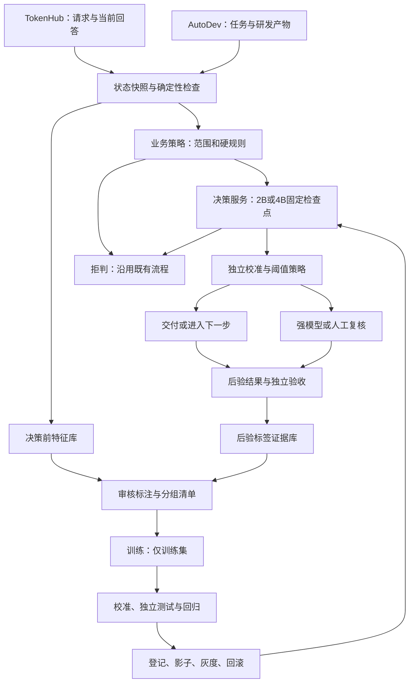

# 书生·明决 2B/4B 实施方案：TokenHub 与 AutoDev

文档版本：1.1.0  
日期：2026-10-20  
状态：实施建议，尚未访问 5070 Ti 或沐曦机器、核查两个平台代码、采集数据或开展训练。  
适用条件：首阶段使用用户提供的 RTX 5070 Ti 16GB 单卡，操作系统、驱动和可用显存待核实；沐曦 8×24GB 作为后续扩展资源，具体卡型及训练能力待确认。  
文档版本独立于平台、模型和接口版本。

## 1. 建设目标与首期决策

基于书生·明决 Intern-Decision 2B/4B，使用自有业务数据训练可部署的决策模型，为 TokenHub 和 AutoDev 提供经过验证、校准、可回滚的判断能力。优先完成 TokenHub 试点，AutoDev 并行采集数据，随后按独立指标上线。

执行顺序已确定为：**5070 Ti 16GB → 明决 2B → BF16 LoRA 优先 → 必要时验证 QLoRA → TokenHub 首个离线实验 → AutoDev 独立实验 → 按效果决定 4B 与沐曦迁移**。沐曦配置核查与首阶段并行，不作为单卡实验的启动条件。

成功的标准是：在明确适用范围内，小模型承担一部分高频判断，达到质量要求，并带来整体成本或人工工作量改善。交付包含自有训练权重、数据清单、验证报告和接入服务；调用开源模型或封装接口本身不代表完成自有训练。

| 平台 | 首期固定问题 | 标签 | 接入位置 | 决策含义 |
| --- | --- | --- | --- | --- |
| TokenHub | 当前回答是否满足直接交付条件？ | `return` / `review` | 当前模型完成回答后、向用户交付前；首期旁路 | `return` 表示可交付；`review` 表示需进一步复核，不保证换强模型就能解决 |
| AutoDev | 当前研发产物是否满足进入下一步的条件？ | `continue` / `review` | 测试和确定性检查完成后、阶段流转前 | `continue` 只允许进入既有下一步；`review` 进入强模型或人工复核 |

业务策略另外处理 `abstain`：缺字段、超长、范围外、服务异常或置信度不足时拒判，走既有流程。拒判不是第三个监督标签；真实存在的“证据不足，需要复核”可以标为 `review`。

首期限定内部试点租户、中文技术问答/代码任务和固定输入协议。先排除实时事实、专业高风险咨询、超长多轮会话、需要联网取证但没有证据的请求。实际任务目录在第 1 周由业务负责人冻结。

不包含首轮请求的最佳模型选择、任意工具选择、自动合并/部署、图片审核、通用业务评分、27B 训练和强化学习。后续扩展必须另建标签与验收集。首轮路由与回答后的质量审核是不同任务，不能共用一个验收结论。

## 2. 技术路线与已核实边界

截至本文日期，公开项目支持类型化选择、是非与评分，提供训练、推理及校准代码。其方法在固定决策位置读取候选答案 logits；输出 JSON 外壳不等于让模型生成文字概率。官方训练数据未公开，需要自行建设业务数据。[上游项目](https://github.com/InternLM/Intern-Decision)

**纠正此前的初步表述：公开训练配置是冻结视觉路径、训练语言骨干并采用 FSDP；不能当作已经可用的 LoRA 配方。** 官方配置还关闭了自动续训和中间快照，长作业前需要补齐恢复验证，或接受可控的整轮重跑方案。[官方训练配置](https://github.com/InternLM/Intern-Decision/blob/main/configs/training/qwen35.py)

| 路线 | 定位 | 执行条件 |
| --- | --- | --- |
| 开源 2B/4B 原始权重 | 首个效果和性能基线 | 确认权重 revision、模型许可、处理器和依赖；2B 首先完成 5070 Ti 推理验证 |
| 5070 Ti＋2B BF16 LoRA | 当前首选自有训练路线 | 按第 8.2 节完成适配、显存与梯度验证；保留原决策监督语义 |
| 5070 Ti＋2B QLoRA | BF16 LoRA 显存不足时的备选 | 先验证 Blackwell 量化算子、反向和重载；单独建立量化基线 |
| 2B 官方语言骨干微调 | 沐曦多卡的后续对照 | 分布式、精度、损失及保存加载均通过；不在单卡 16GB 上作为首期要求 |
| 4B LoRA/QLoRA | 2B 收益不足时的扩展候选 | 重新核验显存和业务收益，不提前并入本轮单卡任务 |
| 4B 官方语言骨干微调 | 2B 未达质量门槛时的升级候选 | 多卡分片和内存实测通过；独立完成 4B 训练与验证 |

首期以两套独立业务检查点交付：TokenHub 与 AutoDev 共用训练框架、采集规范和推理服务协议，分别维护权重/适配器、校准、阈值和验收结果。先验证单任务，再决定是否训练共享多任务版本，避免相互干扰。

本路线使用上游明决对应的 Qwen3.5 家族，不因其他社区案例采用 Qwen3.8 就直接替换基座。起训前选择“从已训练明决检查点继续训练”或“从兼容 Qwen3.5 基座训练”，记录真实来源，二者效果不等同。

沐曦已发布明决适配公告；这只支持把它列为优先候选，不能证明未知卡型已支持相同版本的训练链路。[沐曦新闻中心：2026-09-29 明决适配公告](https://www.metax-tech.com/news.html)

## 3. 架构、数据流与责任边界



模型仅给建议与概率；权限、确定性检查、业务流转与回退由平台策略执行。超时不阻断原有服务。TokenHub 流式响应首期只做旁路，模型无法在内容已经发给用户后“撤回”；要启用交付前拦截，必须显式采用缓冲模式，并验收首字延迟。

闭环定义：新案例进入待审核池，经标注和训练形成候选版本，通过独立验证才替换线上版本。模型不能将自己的输出直接当标签自动训练上线。AutoDev 的 Prompt/Skill 改进同样经过旧任务回归、候选比较和受控发布；单次模型判定不等于改进已被证明。

## 4. 数据采集：两个平台分别采什么

### 4.1 共用事件与存储

新增以下逻辑事件，具体埋点位置需要第 1 周检查平台代码后确定；这些是拟建接口，不代表平台已经存在。

| 事件 | 触发点 | 必填信息 |
| --- | --- | --- |
| `decision.snapshot` | 模型判断前 | 决策时间、任务、候选产物、当时可见证据、检查结果、上下文版本 |
| `decision.result` | 推理结束或失败 | 输入哈希、概率、原始标签、策略动作、拒判原因、版本、耗时 |
| `decision.action` | 平台执行动作后 | 实际动作、覆盖来源、复核路径、关联请求 ID |
| `decision.outcome` | 后续结果出现 | 独立验收、用户修改/重试、可执行结果、证据时间、未观察到结果的原因 |

事件统一包含 `event_id`、`schema_version`、`tenant_id`、`trace_id`、`decision_id`、`task_id`、`occurred_at`、`ingested_at`。同一事件 ID 幂等去重，重试只补送，不重复生成样本；后验结果迟到可以追加，不覆盖原始快照。

建议保存四类逻辑资料：脱敏决策前快照、受控后验证据、标注与裁决记录、不可变数据集清单。采集失败进入可重试队列并监控缺口。内容加密存储、按租户授权；密钥、凭据和个人信息在导出前过滤，不能进入训练示例。

建议试点内容保留 90 天，版本清单及不含正文的审计元数据保留 1 年；第 1 周按客户约定冻结。撤销授权需停止后续导出，并评估已经训练出的权重是否需要隔离和重训。教师外发、跨租户训练分别登记授权。

### 4.2 TokenHub

采集：任务说明、可用上下文、当前回答、结构校验结果、要求满足清单、当时可用工具证据；另存实际调用模型与配置、首字/总耗时、Token、重试及实际调用成本。模型品牌与实际路由动作保留在元数据，默认不作为语义判断特征，防止学习供应商偏见。

随机抽样正常交付、已升级和失败请求；同时将用户重试、低评分、结构错误、长输入、证据冲突列入问题采样池。每周分别报告自然抽样与问题采样占比。点赞、未投诉、用户离开都不是充分的正确性真值。

建设对照池：对可离线重放的同一请求，固定上下文，保存当前回答与强模型回答，隐藏模型品牌后盲评。先判断当前回答是否合格，再判断升级是否改善；“升级后成功”不能自动推出“原回答必须升级”。涉及工具副作用的任务使用沙箱或不重放。

首期每周目标采集至少 2,000 条合规候选记录，实际吞吐不足则延长采集窗口，不以合成请求冒充真实流量。

### 4.3 AutoDev

采集：任务与验收条件、变更 diff/产物、受影响文件摘要、运行环境、测试命令与结果、失败日志、检查覆盖范围、当时可见的需求证据。快照必须绑定仓库基线与产物哈希，测试结果须绑定同一产物，避免拿旧测试为新代码背书。

后验单独存储：人工审查结论、遗漏条件、修复后的 diff、回归结果、任务最终是否验收。模型自报“完成”、命令返回零、普通后续消息均不直接当语义合格金标。

明确测试已失败等可确定问题先由规则处理。训练池保留这些案例用于识别流程，但语义模型验收主要针对硬规则通过后剩余的任务，不能靠大量简单失败样本抬高成绩。

首期每周目标至少 500 条阶段快照。相同任务多个阶段可采集，但它们属于同一个关联组，不能当成完全独立任务，也不能跨训练与测试拆分。

## 5. 标注标准与实施

### 5.1 二元标签与 unknown

| 判断 | TokenHub 标准 | AutoDev 标准 |
| --- | --- | --- |
| 合格：`return` / `continue` | 满足任务必需条件；无已确认实质错误；关键主张有适用证据 | 满足本阶段冻结的验收条件；证据绑定当前产物；无已确认遗漏或语义缺陷 |
| 需复核：`review` | 存在实质错误、遗漏要求、证据冲突或明确缺少关键依据 | 约束遗漏、补丁与需求不符、关键验证缺失、表面通过但证据不支持结论 |
| 标注状态：`unknown` | 要求歧义或无法获得可靠真值 | 无法复现、环境丢失或领域专家无法裁决 |

`unknown` 不进入二元监督损失，单列比例并补证据。不要把所有无法判断都改成 `review`。外部环境故障与模型语义错误分别标识；例如基础设施不可用可以成为策略拒判，不能一律标为代码错误。

评分细则首先写成逐项验收条件，避免用“整体不错”打分。示例：回答必须覆盖 A/B/C 三点，其中 B 依赖给定资料；遗漏 B 或引用资料不支持 B 时标 review。AutoDev 示例：要求只修改指定目录，补丁越界即不能标 continue，即使测试通过。

### 5.2 标注流程

1. 每平台准备 50 条正反例和边界例，发布独立 `rubric_version`。
2. 每平台先双人独立试标 300 条；隐藏模型预测、实际路由、供应商和另一标注者答案。
3. 保存原始判断、`reason_code`、证据引用、标注者及时间；允许查看用于建立真值的后验证据，但这些不能进入推理输入。
4. 分歧与 unknown 由领域专家裁决；无法裁决的保持 unknown。
5. 校准、阈值验证、锁定测试和挑战集全部双标；训练集至少双标 20%，所有 silver 转金标及争议条目必须人工复核。
6. 每批加入 5% 隐藏重复、10% 专家抽查；规则变更后重标受影响样本并更新清单。

建议质量门槛：原始双标一致率 ≥85%、Cohen kappa ≥0.70、隐藏重复一致率 ≥90%、专家抽查错误率 ≤5%。同时报告类别比例和分歧类型；一致率在裁决前计算。unknown 超过 15% 时优先修订任务范围和证据采集。

教师模型仅用于训练池预标注和困难样本发现。教师意见标记为 silver，不进入独立金标测试；裁决依据是事实和业务标准，不是多个模型投票数。

## 6. 数据规模、切分与防泄漏

首轮每平台先完成约 2,000 条审核开发数据，用于验证训练是否有收益。最终每平台计划 6,600 条金标，两平台合计 13,200 条；这是建设目标，尚无可用数据量审计结论。

| 集合 | 每平台目标 | 用途 |
| --- | ---: | --- |
| 训练集 | 3,600 | 梯度训练；可以额外加入明确标记的 silver |
| 开发集 | 600 | 模型、超参及输入方案选择 |
| 概率校准集 | 300 | 仅拟合该检查点的温度等校准参数 |
| 阈值验证集 | 300 | 选择业务阈值并冻结策略 |
| 自然分布锁定测试 | 1,200 | 最终业务质量、覆盖率及收益验证 |
| 独立挑战集 | 600 | 稀有错误、冲突证据、长输入、注入、范围外任务 |

拆分前关联同会话、同任务、同仓库问题、相同模板近重复、重放结果与人工变体；整个关联组分到同一集合。AutoDev 测试至少留出未见任务/仓库组，TokenHub 留出新时间窗口与模板组；时间有交叉的关联组整体移出训练池。

自然测试保持试点分布，不为了凑 review 数量而平衡采样。风险样本不足就扩大连续采集；额外富集风险测试另表报告，不能替代自然分布指标。目标每平台自然测试至少 500 个独立任务组，并争取 ≥100 个 review 独立组；最终是否足以验收以置信区间为准。

数据清单固定输入/标签哈希、group_id、split、来源、授权、时间、rubric、schema、剔除原因。近重复检测与人工抽查共同出具隔离报告。测试结果发布后该集成为回归集，下一次正式晋级增加新时间窗口盲测，避免反复调参污染测试。

后验事实、教师答案、最终路由、修复后产物、金标和标签理由不能拼入 state；每条训练和推理输入由同一个特征构建器生成。生产日志引用必须在推理前解析成脱敏、受长度约束的内容，不能让模型直接访问任意内部 URL。

## 7. 数据契约与接口

### 7.1 上游训练记录

采用 UTF-8 JSONL，每行一个对象。下面展开用于阅读，是拟建业务示例；上游要求 `targets` 与可见状态分离，并保留问题和选项顺序。训练格式采用硬标签，不直接塞入教师概率。[官方数据格式](https://github.com/InternLM/Intern-Decision/blob/main/docs/DATA.md)

```json
{
  "id": "th-synthetic-0001",
  "state": {
    "task": "根据给定资料列出三项限制",
    "context": "资料说明存在 A、B、C 三项限制",
    "answer": "存在 A、B 两项限制",
    "checks": {"format_valid": true}
  },
  "images": [],
  "questions": {
    "delivery": {
      "type": "choice",
      "instructions": "判断当前回答是否满足全部交付条件；遗漏必需内容应复核。",
      "criteria": {"return": "满足交付条件", "review": "需要进一步复核"}
    }
  },
  "targets": {"delivery": {"label": "review"}}
}
```

AutoDev 使用同样外壳，将 state 替换为任务、阶段条件、产物与测试证据，将问题名设为 `stage_gate`、选项设为 `continue` / `review`。推理请求删除 targets。标注理由、来源和分组保存于独立 manifest，不塞入 state。

### 7.2 平台包装接口（拟新增）

| 接口 | 输入/输出与约束 |
| --- | --- |
| `POST /v1/business-decisions` | 输入 request_id、task_type、scope_version、state、evidence_hash、deadline；输出 decision_id、标签概率、原始建议、策略动作、拒判原因及版本 |
| `POST /v1/decision-events` | 写入上述事件；按租户＋event_id 幂等，返回接收状态；失败可重试 |
| `POST /v1/decision-feedback` | 写入后验事实与人工裁决引用；版本化追加，不直接改训练标签 |
| `GET /health` | 进程存活；不代表模型可用 |
| `GET /ready` | 检查权重、校准、策略及设备已就绪 |

上游提供决策推理接口；上述 business-decisions 是我们拟建的业务包装，不与上游字段兼容性混为一谈。包装层固定问题模板，平台调用方不能任意修改线上标签定义。

响应至少包含 `model_id`、`model_revision`、`calibration_id`、`policy_version`、`schema_version`、`input_hash`、`latency_ms`、`applicable`。API 通过 `X-App-Version` 暴露服务版本，与服务发行版本一致；模型版本单独记录。

概率来自合法候选 logits，拒判或故障不返回伪造的 0.5。语义不确定时返回 `abstain` 和既有流程；模型推荐 review 不直接等同平台必然调用强模型，策略先识别重试、缺证据及人工处理等原因。

初始模型可见长度上限建议 2,048 token，随后单独验证 4,096 token；包含模板及问题定义。关键证据装不下时拒判，不静默截断。初始单请求超时预算 1 秒、平台重试最多一次且受原 deadline 约束；最终由实测冻结。服务实现租户鉴权、限流、请求体限制、审计和幂等保护。

## 8. 沐曦机器配置核查清单

请管理员按下表填写实际值，输出到硬件盘点记录。不要仅提供“8 卡 24GB”或“兼容 CUDA”。

| 类别 | 必须确认的实际配置 | 验证目的 |
| --- | --- | --- |
| GPU | 品牌、完整型号、物理卡数、单卡可用显存、是否 vGPU/切片、是否独占 | 确认真实资源与是否适合反向训练 |
| 运算精度 | BF16/FP16/FP32 支持、实际训练稳定性、厂商推荐精度 | 不能仅凭显存推断可训练能力 |
| 设备状态 | 温度、功耗限制、设备错误、其他进程占用、长作业稳定性 | 识别资源争用和硬件异常 |
| 主机 | Linux 发行版、内核、CPU 架构/核数、NUMA、内存、可用内存 | 确认镜像和数据加载兼容性 |
| 存储 | 本地 NVMe 可用空间、读写吞吐、模型与数据路径 | 避免训练和保存受网络盘影响 |
| GPU 互连 | PCIe 代际/通道、拓扑、P2P、MetaXLink 是否存在及启用 | 判断分片训练和多卡通信成本 |
| 驱动软件 | 驱动、固件、MXMACA/MACA、编译器、MCCL 的精确版本 | 固定可复现依赖矩阵 |
| 训练框架 | 沐曦 PyTorch 构建、Python、XTuner、Transformers、PEFT 的版本/提交 | 验证上游训练路径或 LoRA 备选 |
| 关键算子 | Qwen3.5 注意力及线性注意力相关算子、归一化、交叉熵、反向实现 | 推理能跑不代表训练梯度可用 |
| 多卡能力 | FSDP、混合精度、激活重计算、all-reduce/all-gather 的实测 | 防止只支持普通数据并行 |
| 容器 | 官方镜像完整地址与 digest、设备映射、共享内存、权限 | 避免在系统环境盲装依赖 |
| 运行约束 | 调度器、单作业时限、可用时段、可否断点、网络/镜像访问 | 决定排期与恢复策略 |
| 厂商适配包 | 明决 2B/4B 适配代码、权重 revision、训练/推理分别验证情况 | 确认公告覆盖的具体链路 |
| 负责人 | 管理员、算法负责人、厂商支持渠道 | 问题能定位到具体责任人 |

建议管理员提供设备管理工具输出、拓扑、软件版本和官方镜像信息；具体命令按已安装沐曦工具版本执行，删除主机地址、账号和凭据后归档。本文不提供未经该机器验证的安装命令。

资源建议值：主机内存以 256GB 起步评估，512GB 更有余量；本地 NVMe 建议至少 500GB 空闲，保留多轮权重和临时导出时优先 1TB。它们是容量规划建议，不是官方最低配置，最终按最大检查点、数据副本和实测峰值计算。

BF16 权重粗估：2B 约 4GB，4B 约 8GB；仅反映参数，不含激活、优化器和通信缓冲。完整语言骨干训练会增加大量状态。单卡 24GB 无法凭此断言可全量训练 4B；多卡 192GB 也不会自动成为统一显存。若采用 LoRA，仍要容纳基座与激活；不默认沐曦支持 bitsandbytes 量化训练。

### 8.1 第一道关：硬件与训练冒烟验收

| 步骤 | 要执行的验证 | 通过标准 |
| --- | --- | --- |
| H1 | 2B、4B 各运行至少 100 条固定文本，检查完整概率 | 无 NaN/Inf；合法标签；概率和在容差内；记录峰值显存及耗时 |
| H2 | 2B 用 32–64 条合成记录做 100–300 步小样本训练 | 有限梯度；目标参数改变；固定小样本拟合明显改善；不将其当业务质量证明 |
| H3 | 保存、退出进程、重载并重测 | 权重/处理器/标签映射齐全；预先冻结概率容差；无缺失或意外初始化参数 |
| H4 | 两卡再八卡通信与分片训练 | 所有 rank 更新和保存正确；记录扩展吞吐、通信错误、显存峰值 |
| H5 | 4B 做同样的小步训练及至少 2 小时稳定性测试 | 无 OOM、卡死和无效梯度；吞吐满足后续排期预算 |
| H6 | LoRA 若启用：检查目标模块、决策 token、保存与合并 | 训练前后差异可追踪；未训练到错误位置；合并/重载结果在容差内 |
| H7 | 人为中断并验证恢复；若不支持则测量重跑代价 | 记录确实可恢复的状态；否则单作业长度与重跑预算获实施负责人接受 |

H1 通过而 H2 不通过，仅能登记“可推理”。官方 FSDP 不通时先取得厂商支持或验证 LoRA 适配；不能悄悄换成外部 API 后仍报告自有训练完成。环境定位超过两周则重估时间线，数据建设继续。

### 8.2 RTX 5070 Ti 16GB：2B 单卡微调执行方案

本节是当前首阶段路径，H1～H7 是后续沐曦验证要求。当前仅补充方案，不表示已经安装环境、开发训练适配器或在显卡上完成测试。

#### 8.2.1 环境配置与检查

RTX 5070 Ti 属于 Blackwell、计算能力为 `sm_120`。选择包含该架构支持的 PyTorch/CUDA 构建；PyTorch 2.7 的 CUDA 12.8 构建已引入 Blackwell 支持，但这不是推荐直接安装旧 2.7。当前应结合上游依赖选择兼容组合。[NVIDIA 架构列表](https://developer.nvidia.com/cuda/gpus)、[PyTorch Blackwell 支持](https://pytorch.org/blog/pytorch-2-7/)

| 项目 | 首阶段建议 | 必须记录/验证 |
| --- | --- | --- |
| 系统 | 优先 Ubuntu 22.04/24.04 x86_64；现有 Windows 可使用 WSL2 Linux 环境 | 实际发行版、内核、WSL 版本；原生 Windows 不是首期验证目标 |
| GPU | 单张 RTX 5070 Ti，标称 16GB | `nvidia-smi` 的设备、驱动、可用显存、占用进程；训练尽量独占 |
| 内存/存储 | 建议 RAM 32GB 起、64GB 更宽裕；本地 SSD 至少 100GB 空闲 | 这是实验容量建议，最终按加载、保存及缓存峰值确认 |
| Python | 独立 Python 3.12 虚拟环境或固定容器 | 不覆盖现有项目环境；固定解释器路径 |
| PyTorch | 可优先验证上游 HF 推理环境使用的 Torch 2.9.1，选择支持本卡的 CUDA 12.8 构建；若不兼容再调整完整依赖组合 | 不是已验证训练配方；不能仅凭系统装了 CUDA 就判断 Torch 支持本卡 |
| Transformers | 上游当前 HF 推理依赖为 5.14.1，作为候选起点 | 确认目标检查点模型类可加载且可反向；不能与 XTuner 的 4.57.0 环境混装 |
| PEFT | 选择兼容上述模型类与 Torch 的发布版本 | 记录精确版本，验证注入和保存；不直接沿用 XTuner 的 PEFT 0.14.0 锁定 |
| 注意力/线性注意力 | 使用经过本卡前向、反向验证的后端 | 先验证可用的基础实现，再考虑加速；不保证 SDPA 可替代所有线性注意力算子 |
| bitsandbytes | 仅在 QLoRA 分支安装并验证支持 `sm_120` 的构建 | NF4 前向、反向、保存和重载全部通过后采用 |
| 版本锁 | 固定上游提交、模型 revision、Python/Torch/CUDA/Transformers/PEFT 与算子版本 | 试通后保存锁文件、镜像 digest 或完整包清单，禁止正式实验期间自动升级 |

上述 Torch/Transformers 数字来自上游当前 **HF 推理依赖**，不能当成 LoRA 训练已经兼容的证据。单卡采用独立 HF＋PEFT 适配路径，不直接运行官方 XTuner/FSDP 全骨干脚本，也不照抄其中 Torch 2.6＋CUDA 12.6 的安装示例。[HF 依赖](https://github.com/InternLM/Intern-Decision/blob/main/requirements-inference.txt)、[XTuner 依赖](https://github.com/InternLM/Intern-Decision/blob/main/requirements-xtuner.txt)

环境自检可执行以下只读命令；它们不是安装或训练命令：

```bash
nvidia-smi
python --version
python -m pip show torch transformers peft
python -c 'import torch; print("torch", torch.__version__); print("cuda_build", torch.version.cuda); print("available", torch.cuda.is_available()); print("device", torch.cuda.get_device_name(0)); print("capability", torch.cuda.get_device_capability(0)); print("arch_list", torch.cuda.get_arch_list()); x=torch.randn(128,128,device="cuda",requires_grad=True); x.square().mean().backward(); torch.cuda.synchronize(); print("backward_ok", bool(torch.isfinite(x.grad).all()))'
```

检查命令须在拟用虚拟环境中运行。实际 CUDA 张量运算通过后，再检查 BF16 模型与真实算子；只看 `torch.cuda.is_available()` 不算环境通过。WSL 的 GPU 驱动按 NVIDIA 对应指引维护，不在 Linux 子系统重复安装不匹配的内核显卡驱动。

#### 8.2.2 数据准备与首轮切分

先只做 TokenHub 二元判断，复用第 4～7 节的采集、金标和 JSONL 契约；AutoDev 稍后独立起训。正式 6,600 条/平台计划保留，首轮开发实验采用较小数据包：

| 集合 | 规模建议 | 限定用途 |
| --- | ---: | --- |
| 合成冒烟集 | 32～64 条 | 验证损失、梯度、保存、拟合；不进入业务指标 |
| 训练集 | 1,200 条审核金标 | LoRA 梯度训练 |
| 开发集 | 200 条 | 选学习率、训练轮次及输入长度 |
| 校准集 | 150 条 | 仅拟合概率校准参数 |
| 阈值验证集 | 150 条 | 仅选择业务放行阈值 |
| 试验锁定测试 | 300 条 | 首轮结果报告，不用于调参 |
| 挑战集 | 另加 200 条 | 严重缺陷、遗漏条件、注入、证据冲突等诊断 |

审核业务数据共 2,000 条，另加挑战集；它们不代表 2,200 个独立任务组。先按关联组拆分再导出，执行输入/标签隔离、近重复检查和授权检查。小数据包的风险区间可能很宽，只能支持阶段性可行性结论，不能替代第 10 节正式上线验收。

导出前按实际 tokenizer 统计长度，保存分位数、超长数量、拒判比例和两类分布。首轮模型可见总长度限定 1,024 token（包括问题模板），关键证据放不下的样本单列；通过后再验证 2,048 token。不能截断标准答案或静默丢掉负例。

建议实验资料按 `data/<manifest版本>/`、`configs/`、`runs/<experiment_id>/`、`artifacts/<model_id>/`、`reports/` 分目录。JSONL 与 manifest 分别保存：模型可见字段进入 JSONL，授权、group_id、证据来源、标注理由和 split 存于 manifest。原始敏感内容不上传代码仓库。

#### 8.2.3 LoRA 适配的工程要求

新增一个单卡 HF＋PEFT 训练入口是本轮需要实施的工作，本文没有提供不存在的 `train_lora.py` 命令。开发完成后，应在运行手册记录真实脚本、参数和可复现命令。

1. 从明确的 Intern-Decision 2B 检查点加载处理器、tokenizer、模板、特殊 token 和模型配置；首期不从普通聊天基座冒充明决权重起训。
2. 复用或严格对齐上游决策记录编译与损失语义：固定骨架输入、决策位置监督、正确的 causal shift；不能把它改成普通问答全文 SFT。
3. 冻结基础权重与视觉路径，在语言骨干实际存在的线性模块注入 LoRA。检查模块完整名称及覆盖清单，不盲套其他 Qwen 版本的 `q_proj/v_proj` 名单，也不把全模型 `all-linear` 误用到视觉模块。
4. 校验 `<decision>` 和候选符号与原检查点一致；如确需新增 token，验证对应 embedding/输出映射的训练与保存，不能只增加词表长度。
5. 训练使用决策位置的完整词表交叉熵；推理再对合法候选归一化。实现 chunked/分块损失时先核对与参考实现的损失和梯度，避免长序列完整 logits 造成显存峰值。
6. 单卡关闭 FSDP/DeepSpeed、多模态、KV cache 和复杂 packing；按需要启用激活重计算，验证冻结基座时梯度确实可传到 LoRA。HF 推理后端可加载不意味着现有 inference 包装已支持训练。
7. 默认只训练 LoRA 参数；列出每个可训练模块及总参数量。首个训练步后部分 LoRA 参数可能按初始化方式仍是零梯度，需以多步有效更新和非零总梯度判断，不能要求每个矩阵第一步都改变。
8. 先保存“固定基座 revision＋独立适配器”，验证新进程加载；模型合并作为后续可选导出步骤。不要通过重新下载浮动 main 加载适配器。

PEFT 是实现参数高效训练的工具，目标模块及保存策略仍需由我们适配。[PEFT LoRA 文档](https://huggingface.co/docs/peft/main/package_reference/lora)

#### 8.2.4 训练参数与执行步骤

| 参数 | 首次冒烟 | 首轮业务实验 |
| --- | --- | --- |
| 模型/精度 | 明决 2B，BF16 基座＋LoRA | 相同固定基座与精度 |
| 总输入长度 | 256～512 token | 先 1,024，通过后独立测试 2,048 |
| 每卡 microbatch | 1 | 1 |
| 梯度累积 | 1～4 | 16；单卡有效 batch 为 16 |
| LoRA | rank 8、alpha 16、dropout 0.05 | 先保持；开发集有依据再比较 rank 16 |
| 学习率 | 5e-5 起步 | 比较 2e-5 / 5e-5 / 1e-4，固定小规模试验矩阵 |
| 优化器 | 常规 AdamW，只更新适配器 | 同左；暂不叠加 8bit 优化器复杂度 |
| 训练量 | 100～300 个优化器步，按实际耗时调整 | 预设 1～3 epoch，按开发集选择 |
| 省显存 | 激活重计算、关闭 cache、不做复杂 packing | 同左；记录重计算对吞吐的影响 |
| 保存/恢复 | 一次完整保存与重载 | 每 epoch 及退出前保存；中间点建议每 50 个优化器步 |
| 随机性 | 固定一个种子排障 | 入围方案至少 3 个种子复跑 |

若 1,200 条训练样本、microbatch 1、累积 16，则每轮约 75 个优化器步，具体由样本过滤和尾批处理决定。区分 microstep、optimizer step 和 epoch，不能把累计 16 次前向误报为 16 次参数更新。

执行顺序：

1. **原模型基线**：在固定 100 条记录上运行，保存概率、输入哈希、耗时和显存；记录其实际 BF16 dtype。
2. **小样本拟合**：在冒烟集训练，固定同一批样本比较训练前后损失与准确率，确认存在有效学习；这是工程测试，不作泛化证明。
3. **保存与恢复**：保存适配器、优化器、调度器、随机状态、数据进度；退出后在新进程恢复，验证步数与学习率连续。只加载权重重新开始不能称断点续训。
4. **首轮业务训练**：只用训练集更新参数，开发集选方案；训练日志记录每步耗时、allocated/reserved 峰值、主机内存、损失、梯度范数及是否跳步。
5. **冻结与校准**：固定唯一候选及输入模板，分别执行校准和阈值选择，之后评估试验锁定测试与挑战集。
6. **复跑与交付**：入围配置多种子复跑，输出同集比较和原始预测；确认有业务增益后再补充正式测试数据与 AutoDev 实验。

显存策略按顺序执行：先减少占用进程和序列长度，确认 microbatch 为 1，并检查完整 logits/保存瞬时峰值；再收缩 LoRA 覆盖或 rank。仍不满足时才启用 4bit QLoRA；若最终只能处理过短输入，必须报告业务覆盖受限，不以“能跑”替代可用性。

QLoRA 分支起点为 NF4、BF16 计算、冻结量化基座并训练 LoRA；量化准备、梯度重计算及反向均须验证。重新记录量化前后原模型差异，并与“同量化基座、未训练适配器”比较，区分训练收益与量化影响。不得把量化权重视作无损压缩；量化保存与合并后均重新验证，发布前重新校准。

显存建议通过线为峰值 reserved 不超过实际可用显存的 90%，并覆盖最长样本、评估、保存及重载；这是运行余量目标，不是性能保证。稳定性不足时降低配置后重测，不用预计 16GB 理论容量替代实测。耗时按实测完整 epoch 估算，暂不承诺“几小时训练完成”。

#### 8.2.5 单卡验收：工程可用与业务有效分开

| 编号 | 验收项 | 必交证据与通过条件 |
| --- | --- | --- |
| L1 | 环境与原模型可用 | GPU 型号、`sm_120`、版本清单；真实模型前向和反向通过；无 NaN/Inf |
| L2 | 数据与监督正确 | group 无跨集泄漏；targets 不进入 state；至少 20 条人工核查 token/label 对齐；模板与问题顺序可重现 |
| L3 | LoRA 确实训练 | 可训练模块和参数清单、有效梯度、适配器更新；冻结权重无意外变化；冒烟样本拟合改善 |
| L4 | 16GB 稳定性 | 最长配置下完成至少一个业务 epoch，无 OOM/异常跳步；记录峰值和逐步耗时，保存阶段同样通过 |
| L5 | 重载和恢复 | 新进程重载概率与保存前在冻结容差内；一次中断续训成功；保留基座/适配器/tokenizer 哈希 |
| L6 | 训练收益 | 同输入、同测试集比较规则、未微调 2B 与微调 2B；报告 macro-F1、review 召回、错误率、覆盖率与分组区间 |
| L7 | 校准与健壮性 | 独立校准/阈值记录；报告 ECE/Brier；挑战缺陷逐条处理；选项顺序变换后标签语义映射正确并报告差异 |
| L8 | 交付边界 | 阶段报告明确“可训练/有无增益/尚缺样本”；满足第 10 节前仅限离线或旁路，不接管生产判断 |

重载数值容差应在训练前用固定样本确定，建议先检查最大概率绝对差不超过 1e-3；若后端数值差异需要放宽，保留实测理由与近边界标签变化，不能事后随意放宽以掩盖加载错误。

阶段报告建议生成 `metrics.json` 与 `report.md`，包含原始预测、混淆矩阵、分组数、训练设置、显存、吞吐和失败列表。此处为待实现交付文件，不表示当前目录已经生成了这些训练结果。

#### 8.2.6 首阶段用时与沐曦衔接

建议按依赖安排：第 1～2 个工作日核查硬件与环境；第 3～5 个工作日完成 LoRA 入口、决策损失对齐和 L1～L5；数据准备并行开展，审核数据就绪后再执行首轮业务实验。若自定义模型/算子适配超出此窗口，单列阻塞和修复工作，不承诺五天一定完成。

单卡权重可作为后续沐曦迁移候选，但优先迁移明确基座＋适配器或经验证的 BF16 合并检查点；不要直接假设 NVIDIA bitsandbytes 的量化产物可在沐曦运行。迁移后重测标签映射、原始概率、延迟、数值差异和业务指标，重新验证或拟合校准。推理迁移通过不等于沐曦续训通过。

## 9. 训练实施与实验记录

### 9.1 顺序

1. 固定上游 commit、权重 revision、依赖锁和容器 digest，离线核查所有许可与来源。
2. 首先打通第 8.2 节 5070 Ti 单卡 L1～L5，用少量真实开发数据校验输入、标签和损失对齐；H1～H7 在沐曦阶段执行。
3. 跑现有规则、未微调明决 2B、未微调明决 4B、固定强模型判断四种基线。
4. 先训练 TokenHub 2B，再训练 AutoDev 2B；使用各自开发集选择候选。相同业务固定样本和预算比较 2B/4B，不能因为 4B 更大就默认更好。
5. 2B 质量不足或收益不足时训练 4B；LoRA 适配通过后可以加入同口径比较。
6. 冻结权重，用独立校准集拟合概率参数，再用阈值验证集选放行阈值。
7. 在锁定测试上只做最终评估；通过后进入影子验证和灰度。

### 9.2 起始配置建议

| 项目 | 起点 | 备注 |
| --- | --- | --- |
| 精度 | 厂商验证的 BF16；不支持时验证 FP16 | FP16 检查梯度缩放和溢出，不能仅替换名称 |
| 模式 | 文本输入、固定二元问题 | 不开启图像/视频路径，控制首期复杂度 |
| 序列长度 | 2,048 token | 开发集单列超长拒判比例 |
| 全局 batch | 16 | 按实际吞吐用梯度累积凑齐，记录每卡 microbatch |
| 官方骨干微调学习率 | 2e-6 起，开发集比较 1e-6/2e-6/5e-6 | 来自上游配置起点；不是 LoRA 学习率 |
| LoRA 若采用 | rank 8/16，学习率 1e-5～1e-4 的小规模试验 | 模块列表由实际模型结构确认；独立登记适配工作 |
| 轮数 | 1～3 轮预先定义的试验 | 仅按开发集选优，不按最终测试选轮数 |
| 优化与省显存 | AdamW、激活重计算、兼容的 FSDP | 优化器和分片策略以实际支持为准 |
| 稳定性 | 候选至少 3 个种子复跑 | 报告均值及波动，之后固定唯一发布检查点 |

训练标签使用上游决策位置监督；检查目标 token 只出现在标签侧，禁止把标准答案作为可见输入。先关闭复杂 packing，确认样本边界、因果对齐和梯度后再启用。保存实际可训练参数量、初始加载审计及权重变化证据。

每轮记录 experiment_id、数据 manifest/hash、基座与检查点、代码提交、硬件与镜像、参数、种子、训练损失、验证结果、峰值显存、吞吐、GPU 小时、失败原因。预计耗时用实际 steps × 每步耗时计算，并加入评测、保存和重跑余量；不套用 NVIDIA 案例的小时数。

### 9.3 概率校准与决策策略

温度参数只在独立校准集拟合；重新训练、合并适配器或改变推理后端后重新验证。不同业务、检查点不共用未经验证的温度和阈值。

建议设置放行阈值与复核阈值，中间区域拒判。阈值在独立阈值验证集上按风险上限选择；不能固定写死“0.9 就可信”，也不能在锁定测试上反复搜阈值。校准只改善概率解释，不保证提高分类准确率，更不能保证新分布下同样可靠。

## 10. 验收口径与门槛

以下为建议立项验收值，第 2 周结合流量、错误成本与初始基线冻结。冻结后的标准在测试前登记；数据不足只能报告阶段结果，不能算正式通过。

### 10.1 指标定义

- 漏复核率：金标 review 中，被策略自动放行的比例；拒判后进入既有复核流程不计漏复核。
- 错误放行率：所有自动放行中，金标实际为 review 的比例。它与漏复核率分母不同，均需报告。
- 自动放行覆盖率：适用请求中，策略自动放行比例；另报它占全部请求的比例，避免缩小适用范围抬高覆盖率。
- 总质量：包含小模型放行、复核、拒判回退在内的最终交付合格率，不能只评价模型愿意回答的样本。
- 净成本：小模型服务、额外生成/复核、重试和所需人工的实际成本；开发训练投入单列。Token 账单成本用于内部收益分析，本文不涉及对外收费。

### 10.2 离线质量与业务门槛

| 项目 | TokenHub 建议门槛 | AutoDev 建议门槛 |
| --- | --- | --- |
| 漏复核率 | 点估计 ≤5%，单侧 95% 上界 ≤8% | 点估计 ≤3%，单侧 95% 上界 ≤6% |
| 自动放行错误率 | 单侧 95% 上界 ≤3% | 单侧 95% 上界 ≤2% |
| 自动放行覆盖率 | 适用请求中 ≥30% | 适用阶段中 ≥20% |
| 分类质量 | macro-F1 ≥0.85，并给出各类召回与混淆矩阵 | macro-F1 ≥0.85，并单列遗漏需求类召回 |
| 概率质量 | ECE ≤0.05；同时报告 Brier、NLL、可靠性图与样本量 | 同左；不能拿混合平台平均数掩盖单平台问题 |
| 严重缺陷挑战 | 预定义严重缺陷子集不得自动放行；所有失败逐例复盘 | 同左；自动部署和合并权限始终由业务权限控制 |
| 训练价值 | 相比未微调同尺寸模型，在相同风险约束下覆盖率或质量改善，给出区间 | 同左；若无改善，不认定业务微调收益达标 |

风险上界必须按独立任务组计算。优先每组抽一个主决策计算单侧 Wilson 区间，全部关联行另做分组 bootstrap，采用更保守结论；报告组数与条数，不能把同任务 100 次重试当 100 个独立证据。零观测错误也不等于真实错误率为零。

校准、宏平均指标和挑战通过不能替代错误率门槛。稀有子类样本不足时明确限制适用范围，或继续收集；不得依靠跨平台合并分母“凑过线”。

### 10.3 线上效果与服务门槛

| 项目 | 建议门槛及测量方法 |
| --- | --- |
| 实测延迟 | 初始目标：模型可见 2,048 token 内、并发 4，预热后至少 1,000 请求，包装服务 P95 ≤500ms、P99 ≤1s；硬件测完后在第 2 周冻结最终 SLO |
| 稳定性 | 连续 72 小时影子运行无进程崩溃；可用率 ≥99.5%；超时与拒判分别报告 |
| 结构有效性 | 被接受请求的标签与概率校验通过率 100%；异常必须显式返回并走回退 |
| 版本追踪 | 100% 决策可追踪输入哈希、模型、校准与策略版本 |
| 回退 | 注入模型不可用、超时、缺校准、超长输入，全部沿用既有流程，无请求丢失；避免重复交付 |
| 回滚 | 配置切换后 5 分钟内停止新版本接管；保留在途请求归属和原始证据 |
| TokenHub 收益 | 与现有流程配对/随机试验，最终质量差异的单侧 95% 下界不低于 -1 个百分点，同时每任务净可变成本下降目标 ≥10% |
| AutoDev 收益 | 在相同质量约束下，人工复核时间/阶段下降目标 ≥15%；单列额外验证及强模型成本，不以“少看了几条”替代计时 |

正式非劣检验的样本量按第 2 周测得的基线合格率、组内相关与 -1 个百分点界值计算。1,200 条离线测试通常不足以证明很小的线上差异；72 小时稳定运行也不代表质量验收完成。线上样本不够时保留影子或限量灰度状态。

## 11. 上线步骤、监控与 RSI 更新

1. 离线回放：不改变业务动作，完成各业务独立验收与失败清单。
2. 影子运行至少 7 天：记录建议和实际结果，不拦截流量；审查自然样本及模型/原策略分歧样本。
3. 内部试点约 5%：按租户/任务组稳定分桶，先开放低风险范围，保留对照组；禁止请求级随机导致同一任务跨组。
4. 依次扩大到约 20%、50%：每次都满足冻结的风险、稳定性和收益门槛；时间到了不自动扩大。
5. 全部版本可通过配置关闭，保留规则和原有复核路径。影子数据可用于训练池，不能倒灌已经冻结的测试。

监控按平台、租户、任务族、输入长度、模型版本分组：类别与置信度分布、拒判率、漏复核/错误放行审计、覆盖率、延迟、失败、净成本及人工时间。发现严重缺陷自动放行时立即停止对应范围接管并复盘。

每周审核失败池；每两周按数据量决定是否训练，不能把“按时更新”当质量要求。每轮候选需回归旧任务并验证新时间窗口，满足门槛后替换。Prompt/Skill 变更与模型变更分别版本化，每次比较尽量只改变一个因素。

## 12. 三个月排期、交付与负责人

周期按启动后的第 1～12 周计。以能够取得机器和内部数据授权为前提；硬件兼容性和真实标注吞吐是关键依赖。日期及负责人在启动会填写，不虚构已确认的人力。

| 周次 | 工作与交付 | 退出条件 | 主责 |
| --- | --- | --- | --- |
| 1 | 5070 Ti 环境与 LoRA 适配；沐曦并行盘点；平台埋点审计与标注手册 | L1～L3 及样例核查；每平台有 50 个边界示例；明确数据授权 | 技术负责人＋平台研发＋管理员 |
| 2 | 单卡 L4～L5；每平台 300 条试标；基线小测；冻结验收定义 | 5070 Ti 2B 完成训练/重载/恢复；标注标准可用；冻结 SLO 和采样计划 | 算法＋基础设施＋标注负责人 |
| 3～4 | 平台采集闭环；每平台约 2,000 条审核开发数据；首个 TokenHub 2B | 特征无后验泄漏；展示真实训练增益或明确问题 | TokenHub 研发＋算法 |
| 5～6 | AutoDev 单卡 2B；按需 4B 对照；沐曦 H1～H7 和迁移验证；服务包装 | 两业务分别有可重载检查点；迁移结果单列；冻结实验矩阵 | AutoDev 研发＋算法 |
| 7～8 | 补齐每平台 6,600 条金标目标；冻结四类验证集合；校准和锁定测试 | 数据、权重、阈值及报告哈希齐全；离线门槛通过 | 数据负责人＋独立验收人 |
| 9～10 | 影子 ≥7 天、72 小时稳定性、故障回退/回滚演练 | 风险与服务达标；线上所需样本量明确 | 平台研发＋测试/运维 |
| 11 | 内部低风险范围灰度与对照试验；优先 TokenHub | 达到统计要求后才能扩大；AutoDev 独立评审 | 业务负责人＋验收人 |
| 12 | 正式验收、运行手册、收益与问题清单、下一轮计划 | 达标范围发布；不足部分明确为影子/待验证 | 项目负责人 |

建议核心投入：算法/训练 1 人；TokenHub 与 AutoDev 各 1 名研发按阶段投入；数据/标注负责人 1 人；两名兼职领域标注者及裁决专家；基础设施与独立测试各配置明确责任人。角色可兼任，但最终盲测应由未参与调参的人保管。

标注按每条两次各 3 分钟粗估，13,200 条若全部双标约 1,320 人时，尚不含裁决；因此训练集部分双标、测试全双标，且应以 300 条试标实测时间重新预算。AutoDev 复现实验可能更慢。人员不足时缩小试点任务范围或延长周期，不降低金标要求。

## 13. 必交付物与当前待确认项

| 交付物 | 完成证据 |
| --- | --- |
| 硬件与环境报告 | 5070 Ti 配置和 L1～L8 报告；沐曦阶段另交兼容矩阵、镜像 digest、H1～H7 实测结果 |
| 数据与标签资产 | 字段协议、授权记录、标注手册、分歧记录、冻结 manifest、隔离报告 |
| 两业务训练产物 | 检查点或适配器、处理器/标签映射、复现配置、加载和权重变化审计 |
| 校准与策略 | 每业务/检查点的校准参数、阈值依据、范围版本、拒判与回退规则 |
| 验收报告 | 独立组数、各类错误率及区间、覆盖率、挑战结果、性能和净收益 |
| 接入与运维 | API 协议、版本响应头、监控、故障演练、灰度与回滚记录 |

启动时需要补齐的事实：

- [ ] 5070 Ti 的操作系统、驱动、可用显存和主机 RAM/SSD 已核实，完成独立环境与 2B LoRA 适配。
- [ ] 后续沐曦资源：8 张物理卡及每卡可用显存已核实。
- [ ] 厂商确认具体卡型对应的明决训练路径，而不只是推理适配。
- [ ] 获得精确驱动/MACA/PyTorch/XTuner 版本及可用镜像。
- [ ] 核查 TokenHub 与 AutoDev 已有埋点、可导出数据量与后验真值覆盖。
- [ ] 明确试点租户、任务目录、数据授权、标注人员和独立验收人。
- [ ] 明确既有质量与成本基线，冻结最终风险与服务门槛。

建议立项顺序：先用两周证明“机器可训练、数据能形成可靠标签”；再用两周证明 TokenHub 2B 有真实增益；达到阶段门槛后扩展 AutoDev 和 4B。每一步都保留可检查的产物与失败证据。

## 14. 资料来源与使用边界

以下为截至 2026-10-20 核对的公开资料。上游 main 与权重可能变化，实施时须固定提交和 revision；文中的排期、数据量、指标、接口与资源建议是本项目设计，并非上游实测承诺。

1. [Intern-Decision 项目](https://github.com/InternLM/Intern-Decision)：训练与推理能力及运行约束。
2. [官方数据契约](https://github.com/InternLM/Intern-Decision/blob/main/docs/DATA.md)：JSONL、监督标签和推理记录约束。
3. [官方训练配置](https://github.com/InternLM/Intern-Decision/blob/main/configs/training/qwen35.py)：语言骨干训练、FSDP 与保存配置。
4. [官方模型集合](https://huggingface.co/collections/internlm/intern-decision)：起训前选择明确的 2B/4B 权重版本。
5. [沐曦新闻中心](https://www.metax-tech.com/news.html)：2026-09-29 明决适配公告，具体卡型和训练链路仍需厂商确认。
6. [沐曦 MXMACA 技术报告](https://www.metax-tech.com/ndetail/12532.html)：软件生态背景，不能替代本机训练验证。
7. [bitsandbytes 安装支持说明](https://huggingface.co/docs/bitsandbytes/main/en/installation)：不能默认 NVIDIA 量化训练教程直接适配沐曦。
8. [NVIDIA CUDA GPU 架构列表](https://developer.nvidia.com/cuda/gpus)：RTX 5070 Ti 的计算能力。
9. [PyTorch Blackwell 支持](https://pytorch.org/blog/pytorch-2-7/)：选择相符 CUDA 构建的依据。
10. [HF 推理依赖](https://github.com/InternLM/Intern-Decision/blob/main/requirements-inference.txt)与[XTuner 依赖](https://github.com/InternLM/Intern-Decision/blob/main/requirements-xtuner.txt)：不同环境版本不可直接混用。
11. [PEFT LoRA 文档](https://huggingface.co/docs/peft/main/package_reference/lora)：适配器工程的参考，不能代替本机与明决训练验证。

本方案保留此前“小模型详细需求”的证据隔离、拒判和独立验收原则，具体模型与实施顺序以本文为准；未修改此前 PPT 和立项文档。

## 15. 文档变更记录

### 1.1.0 — 2026-10-20

- 增加 RTX 5070 Ti 16GB＋明决 2B 单卡首阶段路线，明确 BF16 LoRA 优先、QLoRA 备选及待适配边界。
- 补齐环境核查、2,000 条首轮业务数据切分、训练配置、执行步骤、L1～L8 验收与迁移要求。
- 同步调整首选技术路线、十二周排期、交付物与配置待确认项。

### 1.0.0 — 2026-10-20

- 建立明决 2B/4B 在 TokenHub 与 AutoDev 的数据、训练、验证、接口和沐曦配置方案。
